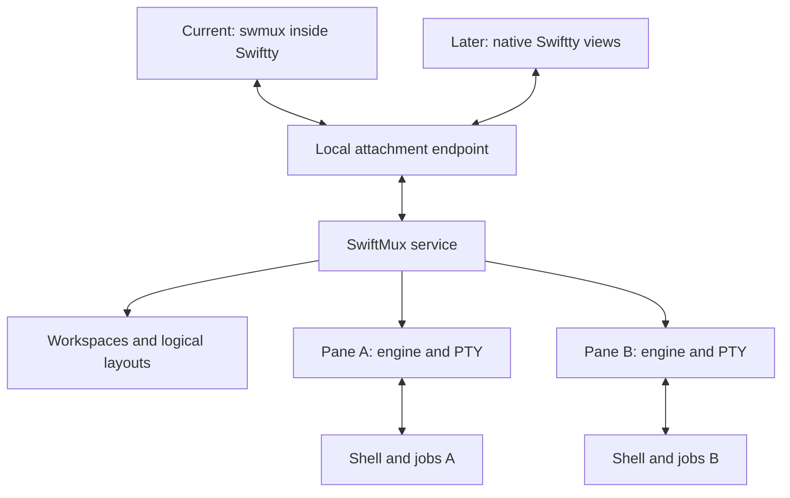

# SwiftMux: a Swiftty-only macOS multiplexer

**Version:** 0.2 — simplified scope and expanded native application design  
**Date:** 2026-10-10  
**Platform:** macOS 27.0; Swift 6.4 or a later explicitly tested toolchain, in Swift 6 language mode  
**Status:** Implemented on branch `feat/swiftmux`. Acceptance evidence and measurements are recorded in section 11.

## 1. Product decision and delivery sequence

Build a persistent local terminal-session service for Swiftty. SwiftMux owns shells, PTYs, terminal emulation, bounded history and logical workspace layouts. Swiftty is the only supported frontend product.

Preserve the requested sequence: first a small `swmux` terminal attachment running inside a supported Swiftty build; later, native Swiftty pane views attach directly and render owned frames through Metal. Both use the same service, identities, input semantics and frame contract. Native integration is specified now but is not a gate for the initial terminal release.

**The largest optional simplification is to skip the terminal attachment stage and implement the native adapter first.** That is a product choice, not a consequence of merely restricting the terminal host. This document retains the terminal stage so the later native application remains a distinct delivery phase.

### What changes from version 0.1

| Area | Swiftty-hosted terminal phase | Later native frame phase |
|---|---|---|
| Terminal support | One pinned, tested Swiftty profile | Direct application/service contract |
| Generic outer terminfo and compatibility overrides | Remove after the fixed profile is verified | Unnecessary |
| Outer terminal renderer and key-byte decoder | Keep a small fixed implementation | Replace with Metal and AppKit input |
| Outer raw mode, prefix and paste parsing | Keep | Unnecessary |
| Borders, status and workspace presentation | Small terminal compositor | Native tabs, dividers, menus and pane views |
| Inner PTY, VT parser, history, replies and `TERM` | Keep | Keep |
| Automation and configuration | Basic commands and settings only | Same typed actions, native preferences |
| Frontend concurrency | One controller and at most four local read-only observers per workspace | Same attachment rules; one workspace window |

A fixed host removes a compatibility matrix. It does not remove the outer terminal protocol while `swmux` is still a terminal application. Native attachment removes that protocol from its own path.

### Minimum product

Provide named workspaces, ordered terminal tabs, split panes, focus, zoom, resize, detach/reattach, bounded scrollback, selection/copy and literal text search. Use these terms consistently:

| Product term | Meaning | tmux analogy |
|---|---|---|
| Workspace | Persistent group of terminal tabs | Session |
| Terminal tab | Ordered item containing a split tree | Window |
| Pane | One PTY, process lifecycle and authoritative terminal | Pane |
| Native window | AppKit presentation container, introduced later | Frontend UI, not a server window |

Each workspace has one controlling attachment and at most four authenticated same-user local observers. The cap is fixed. A connection that does not request a role attaches as that controller. A second controller is refused until an explicit takeover. Observers may subscribe, scroll and search; they cannot write. Simultaneous writers are not supported. Other workspaces and inactive tabs continue running. A lost controller connection releases only its writer lease through the input-cancellation barrier; observers and PTYs stay. A lost observer drops only that viewer. This does not authorize a remote or roaming observer.

Defer tmux command/config/plugin compatibility, linked tabs/session groups, broad scripting, third-party frontend APIs, advanced keyboard protocols, application mouse reporting, terminal graphics, network transports, multi-user sharing and crash/reboot restoration. Native pointer selection and scrolling are included later; mouse reporting to programs is a separate extension. The earlier SSH/SFTP and RST designs remain separate specifications.

Pin the compiler, SDK, Swiftty revision and terminal profile together. Start validation on Apple silicon; publish only combinations actually built and tested. All numerical limits below are proposed starting budgets, not measured capabilities.

## 2. Shared architecture and ownership



The two frontends share one service and are not simultaneous writers. A workspace has one controller; local read-only observers may attach beside it, as specified in §3. The service never requires a connected view to retain a pane.

| Owner | Responsibilities |
|---|---|
| SwiftMux service | Workspace graph, stable IDs, one writer lease and local observer records, layout revisions, environment snapshots, lifecycle and limits |
| Pane runtime | PTY master, child PID, terminal engine, modes, history, query replies, ordered input writer and final-output drainage |
| Terminal frontend | Outer tty state, fixed-profile input decoder, prefix, composed display and local copy action |
| Native frontend | AppKit windows/views, pixel layout, fonts, Metal resources, focus, IME, native gestures and accessibility presentation |

The service persists logical split axes, ratios, pane order, active tab/pane and zoom state. It does not persist AppKit objects, screen coordinates, font atlases or Metal buffers. Frontends translate their own available area into pane cell dimensions.

The inspected tmux baseline is tag 3.8 at `7f2a35ad3321f9ba57a1062ca73b1f3ff26aca53` ([pinned source](https://github.com/tmux/tmux/blob/7f2a35ad3321f9ba57a1062ca73b1f3ff26aca53/client.c)). Its server/session/window/pane model is the architectural reference; matching tmux's interfaces is outside scope. [S1]

### One service activation model

For this Swiftty-only package, the proposed distribution is a Swiftty app containing an unprivileged SwiftMux LaunchAgent and the optional `swmux` client. Register the agent through `SMAppService`; expose one local Mach/XPC endpoint. Both the terminal client and later native views connect to it. This brings helper packaging into the first phase but avoids a second startup mechanism or a later transport migration. [S2], [S3]

Run the agent directly under launchd; it does not self-fork, call `setsid` or perform a second daemonization sequence. Only a fresh PTY launcher establishes a terminal session for its shell. Use an on-demand job without unconditional restart or memory-pressure exit policy for active terminal sessions. The service stays in its event loop while workspaces, retained exit screens, interactive attachments, pending launches or teardowns exist. It may exit only at an ordered empty-state barrier. App disconnection alone is not that barrier. Respect launchd's launch-throttling behavior when choosing an empty-service idle delay. [S4]

An app connection used for helper status/registration is not a workspace attachment. Opening the Swiftty host must not acquire or steal the terminal client's interactive lease. Status queries may remain available while a writer is attached.

An ordinary embedded XPC service is unsuitable as the sole PTY owner: Apple documents that this service type is tied to its client process and exits with it. A LaunchAgent using XPC has a different lifetime. [S2]

Assume Developer ID distribution outside the App Sandbox for this edition. Agent registration is user-controlled; reflect denied or disabled status accurately and explain that the helper retains terminals after app closure. Do not bypass disabled registration by silently spawning a second service. No privileged daemon or administrator-level terminal owner is required. [S3], [S5]

## 3. Shared state, geometry and attachment

Use opaque `ServerInstanceID`, `WorkspaceID`, `TabID`, `PaneID` and `AttachmentID` values. Names and indexes are display labels. A new service process receives a new instance ID; old handles and input leases are invalid even if human-readable names match.

Each workspace owns tabs; each tab owns a split tree with `leftRight` or `topBottom` axes. Tabs are not shared across workspaces. The service validates layout mutations before committing them. Spawn completion carries a creation generation: if its pane was removed meanwhile, terminate/reap the stale successful child and release its descriptors.

The frontend submits a bounded **batch of pane cell sizes** with its attachment ID, layout revision and geometry generation. Validate pane membership, positive dimensions and limits. Apply each accepted engine resize and `TIOCSWINSZ` in that pane's ordered execution path. Publish frames labelled with the accepted geometry; do not present a frame as if a pending resize had already completed. A frame's geometry revision is owned by the pane and advances with every applied resize, whichever lease sent it; the client's batch generation orders only that lease's own batches.

Decoration belongs to the frontend. The terminal client subtracts its one-cell dividers and status row. The native app subtracts actual AppKit divider/header space and computes columns/rows from content pixels and font cell metrics. The shared layout protocol contains no mandatory one-cell border.

Inactive tabs and detached panes retain their last valid dimensions. Zoom changes the displayed pane sizes while retaining the original split tree. Default split minima are 10 columns by 2 rows. When the available area is too small, retain valid pane dimensions and show a clipped/size-constrained presentation; never resize a PTY to zero.

On attachment, establish the controller lease or the observer record and the workspace snapshot at a server ordering barrier, then subscribe to visible pane frames. The protocol version changes only when a running service of the previous version could not decode a request (version 2 changed `attach` to carry `{selector, role}`); additive requests are negotiated with hello capabilities and `ServiceFeatures`, so a stale agent is reported as a different version instead of failing to decode. An attach always names its role (`{selector, role}`). A second controller is refused. Hello capabilities name attach readiness, observers and viewer viewports, and the service enforces them: an observer attach or `setViewport` the hello did not negotiate is refused. A hello that omits them attaches only as the controller and is not sent `ready`.

An attachment that asked for attach readiness is not Ready until it has installed and acknowledged a complete current owned cell frame for every required visible pane. Required panes are the subscription intersected with the visible tab, or the zoomed pane alone when the tab is zoomed. Hidden panes do not block Ready. An empty subscription while visible panes exist does not publish Ready. History fetch is not on this path. The `ready` event names the attachment, the server instance and those panes' frame and geometry revisions. The client records it only when both identities match the connection. Reattach to the same shell presents the current screen from those owned frames. It does not replay PTY bytes. A stale server instance, attachment, geometry revision, layout revision or older frame revision never replaces a newer installed frame. A complete frame resent at the installed revision (on resubscription) is accepted. Native panes render validated cell and viewport frames only. They do not parse PTY output.

Each input record names a pane and an attachment. The service admits controller input only after that attachment's lease exists. A replacement lease is granted only after the previous writer's cancellation cleanup is queued ahead of the new input. The client does not replay uncertain writes. Input does not wait for the Ready event; Ready is the display barrier, and the lease is the write barrier. Closing the connection rejects later old-generation messages.

A workspace grants one controller and at most four observers. Observers are local same-user peers under the existing peer check; a remote client is refused, and this specification does not authorize roaming observers. Each attachment has its own identity and capabilities. Observers may subscribe and unsubscribe, receive frames, scroll and search supported history, and read workspace metadata, including status and workspace lists. The server rejects observer shell input, paste, resize, focus or layout mutation, takeover and destructive actions before it handles the command. A fifth observer is refused. Controller disconnect releases only the writer lease: pending input is cancelled, an open paste drops its unwritten suffix, bytes the kernel has already accepted stay, and observers and PTYs remain. Observer disconnect drops only that viewer's state and frame queues. Takeover is an explicit command that names the lease generation the user agreed to displace. It is not an observer command and never promotes an observer. The previous writer's pending input and unwritten paste suffix are cancelled before the new lease admits input, so the shell sees one writer's bytes and no duplicate of the cancelled suffix.

## 4. Owned frames and local messages

Use one internal, versioned message contract, now `SMX/2`, carried as bounded value payloads over XPC. Start with explicitly tagged Codable JSON records in `Data`; XPC supplies message boundaries. This is a debuggable initial codec, not a performance claim. Avoid remote proxies for terminal objects and avoid exposing raw Swiftty representations.

The handshake identifies protocol version, build, server instance, frontend kind, accepted terminal profile and limits. Allow only explicitly compatible versions. Authenticate the connection using OS-provided peer identity, including the expected user and shipped executable identity; do not trust a claimed PID or bundle ID inside a message. The product is local and unprivileged; it is not a security boundary against the account owner.

Determine the agent's signing policy before listening. Confirmed unsigned or
valid ad-hoc development code uses the mandatory same-user check. Other valid
signed code requires a nonempty team identifier and a parseable same-team peer
requirement. Unexpected lookup or validity errors and incomplete signing
metadata abort startup with exit status 78; they never select development
fallback. Validate the identity before reading signing metadata, since the
Security API can otherwise return partial data for corrupt signatures.

Commands have request IDs and explicit targets. Mutations produce typed results/errors, such as `alreadyAttached`, `staleGeometry`, `paneExited`, `historyUnavailable`, `resourceLimit` and `incompatibleVersion`. Command acknowledgement means the specified operation committed. Input acknowledgement means admission to the ordered writer, not execution by the shell. Never automatically replay uncertain input or mutating commands after connection loss.

### Full pane frames first

A frame contains complete visible terminal state for one pane. Required groups are:

| Group | Contents |
|---|---|
| Identity | Server instance, attachment, pane, frame revision, accepted layout/geometry and viewport revisions |
| Grid | Columns, rows, active screen, row metadata, explicit wide-cell continuation structure |
| Text | Owned Unicode scalars/graphemes and bounded frame-local lookup tables |
| Appearance | Cell styles, colors/palette, row wraps, cursor position/style/visibility and supported overlays |
| Interaction | Relevant terminal modes, history generation/range, stable row addressing for supported history actions |

Only export fields implemented by the product. A later hyperlink feature needs a validated URL table; a cell's internal link ID is insufficient. Enhanced keyboard reporting needs its own mode metadata and tests. It is disabled in the first profile rather than inferred from incomplete frame flags.

Capture cells and metadata in one operation on the pane's terminal queue. Retain the source snapshot while copying it into owned message values. Do not separately read metadata after capture and assume it describes the same terminal state.

Validate byte size before decoding large structures, then validate dimensions, checked arithmetic, total cells, scalar validity, text/table budgets, references, cursor coordinates and lead/continuation-cell consistency. Invalid messages never partially update a presentation. If valid terminal state exceeds an export budget, preserve the session and report the resource limit; do not silently omit cells.

Frames contain no Swift memory layout, pointers, borrowed `Span`, pooled storage IDs, Metal resources or encoded screen images. The server determines terminal column widths; the native renderer uses those widths and performs local glyph shaping/rasterization. It must not recompute terminal layout from `String.count`.

### Bounded frame delivery

Allow one frame delivery in flight and one newest pending complete frame per subscribed pane, for the controller and for each observer, under the same global byte cap and fair scheduling. Observer captures run only while a controller is not waiting on that budget. A slow or disconnected observer cannot stall PTY consumption, control messages or the controller: its queue stays at one in-flight full frame and one replaceable newest frame per subscribed pane, and those bytes count toward the global cap. A client acknowledgement releases transport credit; it is not evidence of GPU completion or user observation. A newer complete frame may replace an unsubmitted older frame. Never discard required ordered input or terminal output bytes under this rule.

Export only subscribed visible panes when exported state changes, at an initial maximum of 60 Hz. Dirty state includes modes, cursor, palette, geometry, history/viewport and search metadata, not only cell damage. Use the ordered state-change boundary; a callback driven only by damaged cells is insufficient. Initial subscription, reattachment and resuming a paused subscription force a complete current frame even if no cells changed. Detached or hidden panes still parse output and maintain bounded history, but produce no unnecessary display frames. The native app may further pause drawing when occluded.

The first version uses full frames and full damage. Deltas, compression, shared memory and IOSurface transfer are deferred until profiling identifies a real bottleneck. No per-client delta baseline is required for reconnecting.

### Shared history and selection

The service owns one PTY grid, bounded history and literal search per pane. Each attachment has its own viewport over that grid: history generation, anchor row and `followTail`. Two observers can rest at different history positions of the same pane. That does not move the controller's viewport or change the PTY size. New PTY output does not move a viewer that is not following the tail. `followTail` resumes the latest screen. An evicted or reflowed anchor fails with `historyUnavailable`. A follow-tail or search resolution that moves the window reports the anchor it actually applied, and that reported anchor is the only replacement. The service never silently shows unrelated text under an old address. Both frontends request bounded viewport frames using pane, screen and history generation and stable row addresses. Do not send the entire history on every update.

A viewer's display size may crop or pad the authoritative grid. Only the controller may change PTY geometry, through the geometry batch and `TIOCSWINSZ`. The controller's viewport request does not crop the grid.

For the smaller first implementation, selection and copy are local operations on one frozen owned viewport frame, including a viewport reached by scrolling or search. Freeze the presentation actually used for interaction, then perform word/line expansion and copy against its immutable cells, graphemes and wrap flags. New output must not change that selection; cancelling or completing selection resumes current frames. Row identity alone cannot protect against in-place edits such as carriage-return progress output.

Initially, users scroll/search to the desired viewport before selecting; selection across multiple fetched pages is deferred. Retain the frozen selection within the same frame budgets. This policy avoids remote selection tokens, server-side retention of historical display frames and synchronous copy RPCs. If multi-page selection is added, give it an explicit bounded immutable-content contract.

### Illustrative application boundary

These are proposed interfaces, not existing Swiftty APIs or compiled code:

```swift
struct PaneFrame: Sendable {
    let identity: FrameIdentity
    let grid: OwnedCellGrid
    let cursor: CursorState
    let modes: SupportedViewModes
    let history: HistoryWindow
}

// A concrete connection is sufficient for the single-product scope.
// Exactly one bounded event consumer; no unbounded event stream.
actor MuxConnection {
    func nextEvent() async throws -> MuxEvent? { /* ... */ }
    func execute(_ command: MuxCommand) async throws -> MuxReply { /* ... */ }
    func send(_ input: MuxInput, to pane: PaneID) async throws { /* ... */ }
    func detach() async { /* bounded; retains panes */ }
}
```

Keep `detach` and `endPane`/`endWorkspace` separate actions. A generic `close()` must not sometimes destroy a shell and sometimes dismiss a view.

## 5. Terminal engine, processes and bounded execution

### One inner terminal per pane

Every PTY output byte enters the pane's parser in order, including while detached. Its engine answers terminal queries through the same pane's writer. Replies do not depend on which pane is focused or on a connected frontend.

Install an inner terminfo entry, provisionally `swmux-256color`, describing the tested engine/input profile. Keep `TERM`, `COLORTERM`, identity/capability replies and accepted mode negotiation consistent. A fixed Swiftty host does not eliminate this contract with programs such as zsh, Vim, less and top. Do not claim tmux identity or enable unsupported protocols simply because upstream Swiftty recognizes them. [S6]

Test incremental UTF-8, combining/CJK/wide cells, supported emoji sequences, cursor movement/saves, autowrap, erasure, scrolling regions, alternate screen, SGR, colors and terminal replies. The inner engine, rather than the outer host, defines these semantics.

### PTY and process correctness

Allocate a PTY with deliberate cooked interactive termios and valid dimensions. Use `posix_spawn` to enter a fresh setup executable, establish the new session and controlling terminal with a checked `login_tty` or equivalent sequence, set standard streams/signals/directory, and exec the shell in place. The launcher does not remain as an extra permanent process. Avoid duplicate session creation. [S7]

First-party logic can remain Swift, including a synchronously entered fresh launcher. A small reviewed native launcher/shim is an explicit acceptable relaxation if necessary. Do not execute ordinary Swift code in a forked pre-exec child of the running service; a C wrapper around only `fork` does not solve inherited-runtime state. [S8]

The inspected Swiftty spawn path uses `openpty`, file actions and `POSIX_SPAWN_SETSID`. Inspected Darwin source performs file actions before session creation. Treat controlling-terminal/job-control validation as a required gate, not an already reproduced Swiftty defect. [S9], [S10]

Preserve argv boundaries, snapshot environment per workspace creation and use an explicit initial directory. Finder-launched apps do not obtain a creating terminal shell's environment automatically; use a deliberate user-shell/login policy. Do not mutate existing pane environments on attachment. Inheriting a live shell's latest directory requires separate shell integration and is deferred.

Ctrl-C/Ctrl-Z are terminal input; the PTY line discipline and foreground group determine their effects. Track child status and PTY completion separately. Reap nonblocking, drain remaining output through EOF, and handle descendants retaining the slave. Explicit termination is bounded and reports truncation if forced. A launcher error-pipe EOF alone is not proof of successful shell exec; combine it with setup messages and child status.

### Execution and budgets

A small service actor owns workspace/lease state. Each pane has one ordered engine/I/O owner. Coalesce readiness and redraw notifications; cap work before admitting it to queues. An actor or `AsyncStream` alone is not backpressure. Do not create one task per byte, cell or read notification. Main-actor code must not block on PTY, IPC, engine work or GPU completion.

Swiftty's `TerminalSession` currently uses a serial Dispatch queue, asynchronous unbounded admission APIs and an uncapped pending-write array. Its teardown also owns the local child. The service adapter must fix these contracts rather than assume wrapping the object in an actor makes them bounded or persistent. [S11]

| Resource | Initial policy |
|---|---|
| Panes | 32 total; reject excess creation |
| History | 10,000 rows and 16 MiB per pane; 128 MiB logical history total |
| PTY input | 256 KiB per pane plus reserved bounded replies/cleanup |
| Read work | Start at 64 KiB per pane turn; measure fairness |
| Frame size | 16 MiB encoded maximum, plus cell/text/table limits |
| Pane dimensions | At most 512 columns by 256 rows |
| Pending frames | One in-flight delivery and one replacement per subscribed pane, for the controller and each observer; global 64 MiB budget |
| Paste | 1 MiB total, 32 KiB maximum chunks, admitted under writer credit |
| Ordinary control records | 256 KiB maximum |

History eviction removes oldest eligible rows and updates addressing generations. These are logical budgets, not an RSS guarantee: include grids, grapheme pools, frame copies, parser control strings and allocator overhead in global memory admission and measurement.

### Shared input and paste rules

Send committed text, supported keys/modifiers, paste operations and later native focus events as semantic input. The service encodes them using authoritative pane modes. One ordered writer handles input and terminal replies.

A paste fixes pane and attachment identity at its start. The service controls its inner bracketed-paste envelope. On user cancellation or a limit failure, stop accepting payload, finish a partly written chunk, discard unstarted chunks and commit a reserved closing marker if needed. When the writer lease ends, on disconnect or explicit takeover, also drop the unwritten suffix of a chunk that has already started, so that tail cannot run as the next writer's input. Bytes the kernel has already accepted stay. Commit the reserved closing marker when the envelope is still open. New input follows that cleanup; it never interleaves inside the old envelope. Defer replies with bounded reserved capacity while necessary.

For unbracketed destinations, a user cancellation stops at a completed chunk boundary. Report partial/aborted paste accurately; already written text cannot be rolled back. A blocked PTY may delay physical completion, so expose pending state and retain order instead of blocking the UI or replaying input.

## 6. Initial frontend: swmux inside Swiftty

This chapter is the complete extra presentation scope for the terminal phase. It is omitted if the product deliberately moves straight to native attachment.

Use one fixed, tested outer profile from the shipped Swiftty build. Implement only its verified cursor/erase/SGR, truecolor, alternate-screen and input sequences. Remove arbitrary-terminal capability discovery, fallback color palettes and compatibility overrides. Outer terminfo lookup is unnecessary once this precise profile is established; the inner terminfo entry remains required.

Decode outer bytes incrementally into text, standard special keys, modifiers, prefix commands and bracketed paste. Preserve a documented ESC inter-byte policy, initially 30 ms; a single host does not resolve ambiguity in ESC-prefixed encodings. Prefix bytes inside paste remain literal. Advanced key and application mouse protocols are disabled for this first profile. [S6]

Compose owned pane frames into one terminal-sized workspace. Draw minimal borders/status, copy/search overlays and the active cursor. Diff against the last fully completed output update. Complete a bounded update once output begins; dropping an encoded suffix could leave the host in the middle of an escape sequence or invalidate the diff baseline. Reconnect, resize or output failure resets the baseline.

Save outer termios before entering raw mode. Track enabled terminal modes, restore them on ordinary detach/errors/handled termination, and restore local state before waiting for service cleanup. Signal handlers only notify normal execution code. Cleanup after an uncatchable kill is outside this guarantee. [S12]

Keep a small command surface: `new`, `list`, `attach` and `detach`, with typed in-session actions for tabs, splits, focus, zoom, copy/search and ending panes. Defer tmux command aliases, target grammar, plugins, format language, arbitrary configuration evaluation and a general automation API. Store a small validated settings model; do not add a separate scripting language.

There are two terminal layers in this phase: the service emulates each pane, and the existing Swiftty host emulates the outer display emitted by `swmux`. That is the cost the later native adapter removes.

## 7. Later frontend: native Swiftty with Metal

### 7.1 What the application becomes

A native Swiftty workspace window attaches to the persistent service. AppKit supplies tabs, split dividers, toolbar/sidebar if useful, menus, focus and window behavior. Each visible pane uses one `MTKView` and one pane presenter/Metal renderer. Every app terminal window is such a workspace window (a plain shell is a one-pane workspace; spec.md "SwiftMux native workspace"). Each window has its own connection and lease; there is no cross-window pane sharing.

The service still owns each pane's virtual terminal. The application receives terminal cells and draws them directly; it does not create a second pane emulator or regenerate ANSI to feed a local `TerminalSession`. No server-side composed workspace bitmap or terminal-sized border grid is required.

The product interaction is: open Swiftty, choose an existing workspace or create one, attach, draw current frames, interact, close the window, and reopen to the same service-owned shell. Native menu actions call the same typed command engine. Font and window preferences remain local; theme changes affecting reported terminal default colors must update the authoritative engine consistently.

### 7.2 Existing renderer versus required adapter

At Swiftty revision `32a57d8945db68a397a58ae3cbe75e63372ea242`, `MetalRenderer` already draws a `RenderSnapshot` into an `MTKView`. The snapshot owns retained storage, but its initializer and storage construction are internal. `TerminalView` owns a concrete local `TerminalSession`, starts it, and stops it on teardown. The direct service frontend is therefore new adapter work, not an existing switch. [S13], [S14], [S15]

Implement three narrow additions:

1. **Owned-frame exporter:** inside the engine module, capture terminal cells and interaction metadata atomically. Add bounded queue admission rather than calling synchronous snapshot APIs from their own queue.
2. **Owned-frame importer:** inside Swiftty's rendering boundary, validate `PaneFrame` and construct independent immutable `RenderSnapshot` storage. Decode/validate off the main actor, then publish the finished presentation atomically.
3. **Concrete `MuxPanePresenter`:** retain local snapshots, schedule drawing, send semantic input, request geometry/history operations, and subscribe/unsubscribe to its pane through the shared connection. An app/workspace controller owns the single connection and interactive lease; closing or rebinding one pane presenter does not detach the workspace. No generic plugin-backend framework is needed.

Replace direct `session.withState`, `mutate`, `send`, `resize`, `start` and `stop` use throughout the view and its extensions. Changing only an initializer leaves input, copy/search, accessibility and lifetime tied to a local PTY. Reuse AppKit behavior and Metal rendering where their dependencies are already appropriate.

At the pinned revision, the `SwifttyCore` target includes renderer/font code and shaders. The implementation splits out a headless `SwifttyEngine` target (section 11); the service holds no native renderer resources. [S16]

### 7.3 Frame-to-Metal flow and lifetime

The exact path is:

1. The service parses pane output and captures a consistent snapshot.
2. Export copies it into a complete owned `PaneFrame` while source storage remains retained.
3. Local IPC delivers the frame; the app validates identities, limits and geometry.
4. The importer builds app-owned snapshot storage with full damage.
5. The presenter stores it as the newest pending frame with a monotonically increasing local presentation sequence.
6. The Metal renderer reads cells/graphemes, fills its instance buffers/atlas, and attempts drawable submission. Only an accepted submission advances the presentation baseline.

Keep the latest decoded/pending frame separate from the frame successfully admitted for drawing. Busy/no-drawable must not publish unseen content as the selection, IME-cursor or accessibility baseline. Track presentation completion where available; bind gestures to the presentation actually being shown. The existing view's assignment of `lastSnapshot` before a `Void`-returning draw call must change along with the renderer's submission result. Local selection overlays are applied through the importer/presenter without changing the frozen terminal content. [S13], [S15]

Reset caches on pane rebind, reattach and server-instance change. The current renderer detects skipped snapshot sequence numbers; preserve that protection, force full damage on initial imports, and prevent overlapping sequence numbers from different panes confusing renderer/accessibility caches. [S13]

**CPU snapshot lifetime and GPU resource lifetime are different.** In the inspected renderer, CPU cells/graphemes are consumed synchronously while encoding and copied into GPU resources. The GPU does not receive the snapshot's CPU cell pointers. Retain the snapshot through extraction and any ongoing local uses such as redraw, selection or accessibility. Retain and protect GPU instance buffers/atlas resources until command completion. An IPC acknowledgement cannot authorize reusing those GPU resources. [S13], [S14]

The current renderer serializes buffer reuse with a semaphore and completion handler; its encode path can block the caller waiting for GPU work. Add a nonblocking submission result such as busy/no-drawable. Keep the newest pending frame and redraw when capacity returns. Do not queue unlimited command buffers or block AppKit behind a slow GPU. Shared devices or atlas optimizations across panes can follow measurement; ownership must remain explicit.

### 7.4 Native geometry and display changes

AppKit lays out the split tree in points. For each pane, compute drawable content pixels and divide by the current cell metrics to obtain integer rows/columns. A divider drag, window resize, font change, backing-scale change or pane zoom may require a new geometry batch even if the logical split tree did not change.

Coalesce superseded pending batches. Apply frames only to their matching pane/geometry binding. While awaiting valid geometry, clip/retain the last valid presentation and reject stale coordinate-based actions. The service returns a complete frame after accepting the resize. Terminal rows belong to the engine; pixel placement belongs to the app.

Hidden tabs keep their previous cell sizes and receive no display subscription. Closing a view releases only its presenter, subscription and GPU resources after their local lifetimes finish.

### 7.5 Keyboard, IME, selection and accessibility

Preserve AppKit's text-input path. Native menu shortcuts handle application actions; the text system handles ordinary characters, dead keys and IME. Marked composition stays in the local preedit overlay. Send committed text once through `insertText`, or one semantic special-key operation when appropriate. Never send both the raw key event and its committed text independently. [S17]

The existing Swiftty input code consults keyboard flags that are not part of `RenderSnapshot`. The conservative first profile avoids enhanced keyboard negotiation; adding it later requires explicit metadata and tests for associated text, repeats, releases and mode changes. Cancel composition on pane rebind/detach so an unfinished composition cannot be committed into another shell. [S14], [S17]

For the first native release, pointer actions focus panes, select/copy text and browse history. AppKit paste is an explicit operation, so no outer bracketed-paste decoder is needed; the shared service-side paste envelope and bounds still apply. Ctrl-C remains terminal input; native Copy is a separate app command. OSC 52 clipboard writes stay disabled; user-initiated copy writes to `NSPasteboard`. The kitty clipboard protocol (OSC 5522) is offered instead, because its reads and writes can be answered by the user: with `ServiceFeatures.kittyClipboard`, the service defers each read and committed write to the controller as a `clipboardRead` or `clipboardWrite` event, sent only to a client whose hello lists `ClientCapabilities.clipboardRequests` (otherwise the service refuses at once). The controller answers with `clipboardReadResult` or `clipboardWriteResult`. Native windows serve reads the user handed over (a paste event's follow-up, a type listing, a remembered password) without asking and prompt for everything else; replies that would not fit the pane's reply reserve answer EIO. A paste while the program enabled kitty paste events (frame mode `kittyPasteEvents`) is sent as `MuxInput.clipboardPaste(types:)`, and the service reports it with a one-time password instead of typing.

Use the shared frozen-frame selection/copy and asynchronous history/search policy from section 4. Visible accessibility text, selected text and IME cursor positioning come from the retained interaction presentation. Do not block a main-actor accessibility callback on IPC. Existing Swiftty mouse/search/accessibility paths require this redirection because several consult live `TerminalSession` state. [S15], [S18]

Resolved hyperlinks, shell prompt navigation and application mouse reporting are added as explicit contracts, advertised in `Welcome.features` (`ServiceFeatures`) so a frontend uses them only with a service that offers them:

- `mouseReporting`: frames carry `mouseTracking`, `mouseButtonMotion`, `mouseAnyMotion` and `alternateScroll` view modes; `MuxInput.mouse` carries viewport-cell events that the service encodes with the pane's authoritative modes and drops while the program is not tracking.
- `historyJumps`: `ScrollRequest.oldest` and `.prompt(n)` (OSC 133 prompts; `notFound` when there is none).
- `terminalControl`: `clearScreen` and `resetTerminal` (RIS of the emulator; the process keeps running).
- `shellIntegration`: `link` (OSC 8 or, on request, a detected URL at a history address), `commandOutput` (scrolls the output into view and returns its rows and full text) and `MuxInput.moveCursor` (click-to-move arrows, written only while the shell edits a command line there; at most `MuxInput.maxCursorMoves`).
- `keypadKeys`: `MuxKey.keypad`, the numeric keypad keys, encoded by the service with the pane's keypad modes. Without it, frontends send keys that type through the input method and the main-keyboard key for the rest.
- `kittyClipboard`: the clipboard events and result commands above, `MuxInput.clipboardPaste` and the `kittyPasteEvents` frame mode.
- `dropTargets`: `PaneFrame.dropTarget` (the types a program registered with kitty drag-and-drop, OSC 72, and its answer for the current drag) and `MuxInput.drag` (move, drop with the dropped data, and leave). Native panes take drops only while their program is registered; dropped items that would not fit one control record or one reply are left out.

Per-attachment viewports are specified in §4.

### 7.6 Workspace window

The native window is the preferred frontend for screenshot-style workspaces. A typical one is a window-level tab strip and a tab with two panes stacked on the left beside one tall pane on the right, each running a different program (an AI assistant, a Git TUI, a game). Switching tabs, rearranging panes or quitting the app leaves every shell and process running. If the `swmux` client has no independent product value, skip its compositor and decoder and deliver the native single-pane proof first (§9).

**The window is not a terminal-character compositor.** AppKit draws the chrome: tab strip, pane headers, split handles and focus. Metal draws only the cell grids. The service keeps the canonical tree from §3. Its `leftRight` axis places children side by side, and `topBottom` stacks them. For the reference composition:

```text
Tab
└── leftRight split (left ~54%, right ~46%)
    ├── topBottom split (top ~47%, bottom ~53%)
    │   ├── Pane A: assistant
    │   └── Pane B: Git TUI
    └── Pane C: Snake
```

The ratios are illustrative. The window derives pixel rectangles from them and from its own size.

| Element | Behaviour |
|---|---|
| Tab strip | One item per service tab, showing an icon, title, activity dot and close button, with a new-tab button at the end. Double-click renames the tab (`renameTab`). Numbered default names show the active pane's program title instead. The strip is a view of service state. |
| Icons | Chosen locally from a fixed SF Symbol table keyed on words in the sanitized title (git, editor, game, assistant, monitor and so on). A program never supplies an image. |
| Pane header | Shown when the tab has more than one pane. It shows the sanitized title, an active-pane marker, an exited marker and an activity dot, with split right, split down, zoom and end actions. It sits outside the cell grid; the pane's rows and columns come from the Metal view beneath it. |
| Titles | `DisplayText.sanitize` drops control, format (including bidi overrides), private-use and unassigned scalars, folds whitespace and limits titles to 120 characters before they reach any chrome or accessibility label. |
| Activity | `MuxEvent.activity(pane)` is sent once when an unsubscribed pane in one of the attached workspace's other tabs changes, and is re-armed when the pane is subscribed again. Starting a pane is not activity. A bell in an unfocused pane also sets the dot. Showing a pane clears it. |
| Splitters | Dragging updates the tree locally at once. `setSplitRatio` requests are coalesced: one is in flight and only the newest ratio is pending. Ratios are clamped so that every pane in each subtree stays at least 10 columns by 2 rows plus its header (`LayoutGeometry.clampedRatio`). Each divider is an accessibility splitter: increment and decrement move it 5%. |
| Focus | Clicking a pane focuses its stable ID and routes input to it. ⌥⌘arrows move focus to the neighbouring pane by geometry. Window and tab focus changes never end processes. |
| Keyboard | Menu key equivalents are handled before the pane sees the key, so app shortcuts never reach a shell: ⌘N new workspace, ⌘T new tab, ⇧⌘O open workspace, ⌘W close window (detach), ⌘D / ⇧⌘D split, ⇧⌘↩ zoom, ⇧⌘] / ⇧⌘[ next/previous tab, ⌃⌘arrows resize, ⌥⌘W end pane, ⌃⌘W end tab. User key bindings run before menu key equivalents while a pane has focus. Pasted text, including shortcut characters, travels only through the paste envelope (§5). |

Leaving a view comes in three kinds, and they are kept distinct. **Hide** (switching tabs) drops the views and subscriptions; the panes keep parsing output, keep their last accepted size and are measured again when shown. **Detach** (closing the window or quitting) releases the lease. **Terminate** (end pane, close tab) ends only its targets, and asks for confirmation first while any of their processes is still running. Disposing a view never terminates anything.

Full-screen programs keep their alternate screen, raw keys, cursor visibility, terminal queries, bracketed paste and resize notifications (§5). A pane too small for its program keeps a valid PTY size and is clipped; it is never resized to zero.

| Milestone | Deliverable | Exit criterion |
|---|---|---|
| A. Native single pane | `MTKView` presents a service-owned PTY through imported frames | Quit/reopen keeps the same shell PID and current screen |
| B. Layout tree | Native tabs and a recursive split tree with persistent pane IDs | The reference composition is reproduced |
| C. Interactive correctness | Focus routing, IME, paste, mouse, resize and TUI modes | A Git TUI and a game run side by side with no misrouted keys |
| D. Lifecycle and history | Detach, tab switching, pane exit, copy/search and frame bounds | Hidden output stays current; reconnecting replays no input and kills no shells |
| E. Polish | Headers, tab metadata, drag handles, accessibility and activity | Acceptance on real macOS 27 hardware with measured memory and latency |

Required regression tests: three independent shells in the reference layout with distinct input routing and process IDs; a hidden tab that keeps running and converges when shown again; rapid resize, zoom and display moves that never restore old dimensions; one pane flooding output while another takes input; pasted shortcut characters that change no layout; IME, grapheme widths and selection over progress output; renderer failure and client crash that neither terminate a PTY nor advance the presentation baseline; and destructive actions that end only their target while view disposal ends nothing.

This section adds no SSH, SFTP, QUIC or mobile roaming. Those transports can attach to the same service-owned panes later under their own specifications.

## 8. Lifetime and upgrades

| Event | Required behavior |
|---|---|
| Terminal detach, native window close or normal app Quit | Release the attachment; retain running panes, layout, history and valid dimensions |
| Client crash or Force Quit | Connection-loss cleanup cancels remaining input and releases the lease; service-owned panes continue |
| Reopen/reattach | Discover the same service instance, obtain complete state/frames and continue existing shells |
| End Pane/Tab/Workspace | Explicitly terminate only the targeted processes under the bounded close policy |
| Shell exits naturally | Drain output and settle status; close the pane or retain its final screen under `remainOnExit` |
| Service crashes or is terminated | Mark its old sessions lost; restart creates a new empty instance |
| Logout/reboot/background item disabled | No process-retention guarantee; accurately reflect unavailable service state |
| Sleep/wake | Retain sessions if the OS retains their processes; no progress guarantee while asleep |

App Quit must not unregister the LaunchAgent or call local terminal teardown for service-owned panes. `remainOnExit` screens keep their workspace present. Live detached sessions have no inactivity expiry in this edition.

Stage updates separately while workspaces exist; staging alone does not change normal admission or replace the installed bundle. When installation begins, quiesce new workspace creation and pane launches. Reach an ordered empty-state barrier after workspaces, retained exit screens, interactive attachments, pending launches and teardowns are gone. An explicit “End workspaces and update” action uses normal bounded termination to reach that same barrier. At the barrier, reject new attachments/mutations while allowing status responses. Await successful unregistration completion, replace the bundle, register the new service and verify its instance/version. Cancellation before unregistration returns normal admission. The connection that began quiescing owns that update barrier: other connections cannot acquire or release it, and losing its owner restores admission unless terminal service shutdown has begun. Apple documents re-registration requirements when the agent executable/plist changes; use completion ordering rather than arbitrary sleep-based sequencing. [S19]

Do not replace a bundle beneath a live old service that will later spawn its launcher from that bundle. Incompatible clients must preserve the old service and explain how to reopen a compatible version or deliberately end sessions. No live PTY handoff, engine hot migration or command replay is included. Support one installed Swiftty bundle/service identity per user initially.

### Native packaging security

The native `Swiftty.app`, its SwiftMux helpers and `swifttyd` are built with
`swift build`; app packaging/signing is handled by `Scripts/package-swiftmux.sh`.
The Xcode app targets' `ENABLE_ENHANCED_SECURITY` setting and arm64e package
configuration do not apply to these SwiftPM products. Enhanced Security
hardened-process entitlements at `codesign` time remain deferred pending separate
Developer ID validation. Existing hardened-runtime signing does not establish
that additional entitlement coverage. See
[the Xcode configuration](spec.roaming.md#25-xcode-security-build-settings) for
the separate mobile, Catalyst, visionOS, tvOS and watchOS decisions.

## 9. Modules and delivery gates

Keep a few useful implementation boundaries; create separate package targets only where dependency isolation helps.

| Boundary | Responsibility |
|---|---|
| SwiftMux service | Workspace commands, ownership, bounded scheduling, per-pane engine/runtime adapters |
| Shared messages | IDs, immutable owned frames, codec, validation and client connection |
| Swiftty engine/render bridge | Consistent frame export and native snapshot import |
| `swmux` terminal frontend | Optional first-stage fixed-profile TTY presentation |
| Swiftty native app | Later remote pane presenters, AppKit layout/input and Metal rendering |
| PTY launcher | Fresh-process terminal setup and exec |

Use Darwin/libSystem and Dispatch behind narrow adapters. Reuse Swiftty's engine and Metal implementation; do not add a new VT parser, terminfo database parser, SSH stack or general transport framework. Swift language safety helps express boundaries but does not prove lower latency, lower memory or better behavior than tmux. Preserve notices for reused code, tables, resources and fixtures.

| Stage | Deliverable | Gate |
|---|---|---|
| 0 — Shared core proof | Pinned build, packaged service, one real shell, owned frame export, controlling tty and bounded I/O | Shell/job-control and process ownership work |
| 1 — Swiftty terminal client | Fixed-profile TTY, create/list/attach/detach, same-PID reattachment | Terminal cleanup, input and retention pass |
| 2 — Small multiplexer release | Tabs/splits, focus/zoom/resize, bounded history/copy/search and limited settings | Shared and TTY acceptance gates below pass |
| 3 — Native single-pane proof | Export/import snapshot, one `MTKView`, semantic input, app Quit/reopen | Same shell renders directly through Metal |
| 4 — Native workspace release | AppKit tabs/dividers, geometry, IME, selection/search, accessibility and packaging | Native acceptance gates pass |

If the standalone terminal command has little product value, skip its presentation work in stages 1–2 and reach the native single-pane proof earlier. The shared multiplexer behavior and tests still apply.

## 10. Acceptance criteria

Section 11 records the evidence for each gate.

| ID | Shared gate | Required result |
|---|---|---|
| C1 | Compiler and package | Pinned Swift 6.4+ and macOS 27 build, signed helper activation and dependency graph verified |
| C2 | PTY/job control | `tty`, `/dev/tty`, foreground groups, Ctrl-C/Ctrl-Z, `bg`/`fg` work |
| C3 | Lifetime | In the signed initial TTY package, detach/client death and hosting Swiftty window close, Quit, crash and Force Quit preserve service instance, shell PID, variables and background jobs; explicit termination ends only its target |
| C4 | Completion | Final output survives natural exit; inherited slave, forced close and late spawn are handled correctly |
| C5 | Terminal behavior | Incremental VT/UTF-8, wide cells, alternate screen, colors, zsh/editor/pager scenarios and detached query replies pass |
| C6 | Geometry and identity | Split/zoom/resize/reattach agree with pane sizes; stale geometry, old leases and replaced server instances are rejected |
| C7 | Input and paste | Exactly ordered input; bounded paste and disconnect cleanup; no automatic replay |
| C8 | Bounds and fairness | Noisy visible/detached panes and a slow client stay within budgets without starving input/control |
| C9 | Owned frames/history | Malformed tables/widths/lengths fail safely; subscription/metadata-only changes produce frames; frozen selection survives in-place edits; stale history never copies different text |
| C10 | Registration and upgrades | Denied/disabled service is respected; pending updates preserve sessions; incompatible app preserves old server |

| Frontend gate | Required result |
|---|---|
| TTY profile | Exact shipped Swiftty profile passes decoder/encoder fixtures; no dependence on other terminal implementations |
| TTY cleanup and output | Normal/error detach restores tty/modes; interrupted output invalidates baseline; paste bypasses prefix |
| Native parity | Export/import retains cells, wraps, colors, cursor and graphemes; compare renderer output with direct snapshots where deterministic |
| Native lifetime | Window close, Quit, crash and Force Quit permit same-shell reattachment; service loss is distinguished |
| Native IME and input | Dead keys, composed text, repeats, Ctrl keys, paste and pane changes deliver intended input once |
| Native layout/history | Divider drag, font/backing-scale changes, search/selection and eviction preserve correct targeting and text |
| Native resource lifetime | Slow GPU, no drawable, dropped frames, redraw/rebind and teardown do not reuse in-flight buffers/stale CPU storage or make pending content the interaction baseline |
| Native accessibility | Visible text/cursor/selection are correct without synchronous remote calls on the main actor |

Measure parser throughput, input-to-display latency, client/service CPU, GPU work and memory at the configured limits. Report hardware, OS, build and workload. In the native phase, include no-client and occluded-window cases. Use results to decide whether a compact codec, deltas, shared resources or shared memory is justified.

## 11. Acceptance and measurement record

Branch `feat/swiftmux`, 2026-10-10. Host: Apple silicon MacBook Pro, 18 cores, macOS 27.0.1 (26A434). Toolchain: Swift 6.4 (swift-6.4-RELEASE), Xcode 27 SDK. Only this combination has been built and tested.

### Acceptance gates (§10)

| Gate | Evidence |
|---|---|
| C1 Compiler and package | Debug and release builds pass. `Scripts/package-swiftmux.sh` produces a hardened-runtime `Swiftty.app`, signed ad hoc or with **Developer ID Application: Dot Media CC (72KB9YQR7B)**; `codesign --verify --strict` passes for both. `swiftty --swiftmux-agent register` moved the agent from `notFound` to `enabled` through `SMAppService`, and launchd started it on demand. On the Developer ID build the agent derives its peer requirement from its team: the team-signed `swmux` is served, and an unsigned client gets no answer and now fails its handshake after 5 s (`PeerIdentityTests`). After the same label is re-signed with a different identity, launchd refuses the spawn (`EX_CONFIG`, stale launch constraint) until the agent is re-registered. The update flow therefore unregisters before it replaces the bundle. Notarization has not been tested. |
| C2 PTY/job control | `ServiceTests.controllingTerminalAndJobControl`: `tty`, `/dev/tty`, session leadership and Ctrl‑C (exit status 130). |
| C3 Lifetime | Run on both the ad-hoc and the Developer ID packages with the agent registered: the service instance, shell PID and background-job PID were unchanged after the app was Force Quit (SIGKILL), quit normally and crashed (SIGSEGV), and `swmux end` ended only its target. `reattachKeepsSameShell` covers client death and reattachment to the same shell, `TerminalClientTests` covers TTY detach, and the native split/close test covers closing the window. |
| C4 Completion | `naturalExitDrainsFinalOutput` (final output and exit status). `lateSpawnIntoEndedPaneIsReaped`. Forced close is bounded: SIGHUP, then SIGKILL after 2 s, and the forced kill is logged. |
| C5 Terminal behaviour | Engine parity in `BridgeTests` (wide, emoji, combining, SGR and underline colours, wraps). `detachedPanesStillAnswerQueries` (DA reply with no frontend attached). Existing Swiftty engine suites. |
| C6 Geometry and identity | `staleGeometryAndAttachmentAreRejected`, `splitZoomAndEndPane`, `incompatibleVersionIsRejected`, and the native split and divider test. |
| C7 Input and paste | `bracketedPasteAndCancelOnDisconnect`, ordered `enqueue`, and the native IME test (text delivered exactly once). Nothing is replayed automatically. |
| C8 Bounds and fairness | `slowClientStaysBoundedAndResponsive`, `inputBeyondWriterCreditIsRejected`, `paneLimitRejectsExcessCreation`, and the 32-pane load below. |
| C9 Owned frames and history | `BridgeTests` (malformed frames rejected), `historyScrollAndSearch` (a stale address is refused), and the native frozen-selection test. |
| C10 Registration and upgrades | `UpdateTests`: staging changes nothing, cancelling restores admission, a barrier timeout preserves sessions, and the update follows the ordered barrier. A wrong-version client gets an explanation instead of replacing the running service. |

Native resource lifetime: in "slow GPU and missing drawables never advance the presented baseline", all in-flight GPU slots are held, newer frames arrive and the presented frame and accessibility text stay unchanged until capacity returns. Content is also never presented while the view is out of its window (an offscreen `MTKView` still hands out drawables, so the pane view now treats that case as no drawable).

Frontend gates: the decoder, diff renderer and full client are exercised against a fake outer terminal parsed by the Swiftty engine (`TerminalFrontendTests`). Native rendering, IME, selection, accessibility, layout and lifetime are covered by `SwifttyAppTests/MuxNativeTests`. These tests use real Metal and real shells, but run without a display link.

### Follow-up gaps closed

| Spec item | Change and evidence |
|---|---|
| §1, §7.5 native search | Find (⌘F, ⌘G, ⇧⌘G) in the native window runs the shared service-side literal search. Test: "native search highlights history and follows the theme". |
| §5 consistent inner identity | Panes answer XTVERSION with `swmux 0.2` and XTGETTCAP `TN` with the inner `TERM`. Kitty keyboard negotiation is not offered, and OSC 52 is not advertised. Tests: `EngineIdentityTests`, `InnerProfileTests.programsSeeOneConsistentIdentity`. While adding the switch, I made the condition explicit on every kitty pattern, because Swift applies a `where` clause only to the last pattern of a `case`. |
| §7.1 theme to the engine | `setTheme` updates every pane's default palette and light/dark scheme, and new panes inherit it. The native app sends it on open, on appearance change and on configuration reload. Tests: `themeUpdatesReportedDefaultColours` (OSC 11 reply) and the native search/theme test. |
| §5 truncation reported | `paneExited` carries `truncated` when an explicit end had to SIGKILL. `swmux` shows a message and the native window shows a subtitle. Test: `forcedTerminationIsReportedAsTruncated`. |
| §8 barrier freezes mutations | While quiescing, only status, detaching, ending sessions, viewing and theme updates are admitted. Test: `barrierRefusesMutationsButAllowsStatusAndEnding`. |
| §7.2 headless engine target | The new `SwifttyEngine` target holds the terminal model, Unicode, input encoding, PTY processes and `SessionConfiguration`. `SwiftMuxService` depends on `SwifttyEngine`, `SwiftMuxProtocol` and `SwiftMuxExport` only, and `swiftmux-agent` links no Metal, CoreText or AppKit (checked with `otool -L` and `nm`). `SwifttyCore` re-exports the engine, so existing users are unchanged. The iOS Simulator build of `SwifttyMobile` succeeds. |

### Native workspace window (§7.6)

| Item | Change and evidence |
|---|---|
| Reference composition | `MuxNativeTests` "reference layout routes input to three distinct shells": the tree is left stack plus tall right pane, the frames match, there are three distinct PIDs, each pane shows only its own input, and directional focus follows geometry. |
| Hidden tabs and activity | "hidden tabs keep running, mark activity and converge on return": no view or subscription while hidden, the tab shows an activity dot, the current screen returns on reselect and the PID is unchanged. `WorkspaceUITests.hiddenPaneActivityIsReportedOnce` checks the service sends one report until the pane is subscribed again. |
| Shortcut characters in paste | "pasted shortcut characters never change the workspace": `⌘T ⌘D` and `C-b` sequences arrive as text, and the layout is unchanged. |
| Destructive actions | "destructive actions confirm and end only their target": declining keeps the pane, disposing its view keeps its process, accepting ends only the target, and a tab whose shell already exited closes without asking. |
| Chrome and accessibility | "headers, tab strip and splitters expose titles and controls": program titles reach the tab, icon and header; the header sits above the cell grid; the splitter is an accessibility element whose increment moves it; 40 rapid drags converge on the last ratio; keyboard resize moves the nearest divider. `WorkspaceUITests` covers sanitizing, the reference geometry and minimum-size clamping. |
| Early-output race | Found by the reference-layout test: a split pane whose shell printed before its record was registered dropped that change notification. The flag that gates notifications then never reset, so the pane sent no further frames. The service now catches up on that output right after registering the pane, which also resets the flag. |

### Unified workspace UI

The app has one window type; spec.md "SwiftMux native workspace" holds the rules.

| Item | Evidence |
|---|---|
| One-shell windows, independent workspaces, Quit detaches all | `WorkspaceCoordinatorTests` "each New Workspace is its own one-shell workspace, and Quit detaches all"; "workspace commands validate against this window's lease". |
| Reveal without a second writer; service-instance keys | "opening a workspace this app shows reveals it without attaching again". |
| Launch choice and settings | `WorkspaceLaunchActionTests`, `WorkspaceLaunchTests`. |
| Unavailable service, retry, no fallback shell | `WorkspaceServiceStartupTests`. |
| Reload to every window, stale frames, attention links | "reload, stale servers and attention links respect every window". |
| Pending operations and open deadlines | `MuxCancellationTests`, `MuxOpenDeadlineTests`. |
| Terminal parity (service) | `TerminalParityTests`: features in the welcome, mouse reports only while tracking, prompt jumps and oldest, command output, links, click-to-move, clear and reset. |
| Terminal parity (pane) | `MuxPaneParityTests`: clicks reach a tracking program, copy on select and command output, ⌘-hover links, prompt jumps and clear, the custom shader. |

### Measurements

From `swift run -c release swiftmux-bench` (`mise run bench-swiftmux`): an in-process service behind real XPC, with real PTY shells and a 32 MiB corpus of SGR, UTF‑8 and wide text.

| Measure | Result |
|---|---|
| Parser throughput, detached pane | 230 MiB/s |
| Parser throughput, attached 200×50 client | 271 MiB/s (60 Hz export cap: 7 frames during the run) |
| Input → frame latency (XPC, PTY echo, export, decode) | p50 1.43 ms, p95 1.55 ms, p99 1.63 ms |
| 200×50 frame | 103 KiB; export+encode p50 0.58 ms; decode+validate+import p50 0.66 ms; GPU render p50 1.03 ms |
| 512×256 frame (dimension limit) | 1.3 MiB; export+encode p50 4.48 ms; decode+validate+import p50 5.17 ms; GPU render p50 5.50 ms |
| 1 MiB paste (paste limit, 32 KiB chunks under writer credit) | 129 ms |
| Literal search over 10,000 history rows (row limit) | 8.96 ms |
| 32 noisy panes, no client (pane limit) | service CPU 334 % (about 32 continuous streams); footprint 200 MiB |
| 32 noisy panes, 1 visible | service CPU 336 %; footprint 346 MiB; 55 frames/s delivered |
| 32 visible noisy panes in one 512×255 tab | service+client CPU 422 %; footprint 624 MiB; 1,836 frames/s (about 57 per pane, at the 60 Hz cap) |
| Idle footprint | 39 MiB |

Contended run (another toolchain build on the same machine, load average 15–20):

| Measure | Result |
|---|---|
| Parser throughput, detached / attached | 99 / 97 MiB/s |
| Input → frame latency | p50 0.56 ms, p95 0.63 ms, p99 1.36 ms |
| 512×256 frame | export+encode p95 12.2 ms; import p95 14.6 ms; GPU p95 14.6 ms |
| 200×50 GPU render, quiet → beside a renderer saturating the GPU with 512×256 frames | p95 2.96 ms → 5.03 ms (still within a 60 Hz frame) |
| 32 visible noisy panes | 1,749 frames/s; footprint 720 MiB |
| Search over 10,000 history rows | 2.79 ms |

History budget: each pane gets up to 16 MiB and 10,000 rows from the shared 128 MiB pool. A 1 MiB minimum is held back for each pane that could still be created, so the total of all pane limits never exceeds 128 MiB (`HistoryBudgetTests`).

The footprint covers the whole bench process, so the client that decodes every frame is included. The JSON codec takes roughly 10 ms per frame at the 512×256 limit, which makes it the first candidate for a compact codec or deltas (§4).

Notarization: the package script signs Developer ID builds with a secure timestamp. When `NOTARY_PROFILE` names a `notarytool` keychain profile, it also submits the app, staples the ticket and runs `spctl --assess`. No notary credentials are stored on this machine, so that step has not run. Without it, Gatekeeper rejects the Developer ID build as `Unnotarized Developer ID`, as expected.

`FrameTimeTests` measures optimized code. It is now enabled only in optimized builds (`swift test -c release`), where it passes with p95 0.68 ms and 1.77 ms. Debug builds skip it rather than failing. The `SnapshotTests` search budget is gated the same way (release p95 0.009 ms). The PTY slave-leak test waited only 1 s for an asynchronous hang-up and failed under full-suite load (also on `main`); it now waits up to 10 s and returns as soon as EOF arrives. Three consecutive full `swift test` runs then passed (1,202 tests each).

## 12. Primary sources and evidence boundary

Swiftty source below is pinned to `32a57d8945db68a397a58ae3cbe75e63372ea242`. Existing API/lifetime statements are source observations; the service, frame importer, presenter and shipping behavior are proposed changes. Apple documentation establishes intended API models; actual macOS 27 runtime behavior remains an acceptance gate.

- [S1] tmux architecture and concepts.
- [S2] Apple XPC service types and process lifetimes.
- [S3] Apple SMAppService registration and authorization.
- [S4] Apple launchd demand activation and user-agent lifecycle.
- [S5] Apple DTS: bundled helper packaging, agent adaptation and sandbox relationships.
- [S6] xterm terminal/input sequences; the project advertises only its tested subset.
- [S7] Apple PTY allocation and controlling-terminal setup.
- [S8] Apple DTS: Swift/runtime considerations after fork and fresh spawning.
- [S9] Swiftty PTY allocation/spawn implementation.
- [S10] Pinned Darwin spawn implementation ordering.
- [S11] Swiftty session queue, input, snapshot and process ownership.
- [S12] Apple terminal attributes.
- [S13] Swiftty Metal renderer and GPU synchronization.
- [S14] Swiftty retained snapshot representation.
- [S15] Swiftty AppKit terminal view dependencies.
- [S16] Swiftty package target boundaries.
- [S17] Swiftty AppKit text/IME input path.
- [S18] Swiftty pointer/selection interaction with terminal state.
- [S19] Apple DTS: helper update and re-registration ordering.

[S1]: https://github.com/tmux/tmux/wiki/Getting-Started
[S2]: https://developer.apple.com/documentation/xpc?language=objc
[S3]: https://developer.apple.com/documentation/servicemanagement/smappservice/register()
[S4]: https://developer.apple.com/library/archive/documentation/MacOSX/Conceptual/BPSystemStartup/Chapters/CreatingLaunchdJobs.html
[S5]: https://developer.apple.com/forums/thread/802443
[S6]: https://invisible-island.net/xterm/ctlseqs/ctlseqs.html
[S7]: https://developer.apple.com/library/archive/documentation/System/Conceptual/ManPages_iPhoneOS/man3/forkpty.3.html
[S8]: https://developer.apple.com/forums/thread/747499
[S9]: https://github.com/chr33s/swiftty/blob/32a57d8945db68a397a58ae3cbe75e63372ea242/Sources/SwifttyCore/Process/PTYProcess.swift
[S10]: https://github.com/apple-oss-distributions/xnu/blob/f6217f891ac0bb64f3d375211650a4c1ff8ca1ea/bsd/kern/kern_exec.c
[S11]: https://github.com/chr33s/swiftty/blob/32a57d8945db68a397a58ae3cbe75e63372ea242/Sources/SwifttyCore/Session/TerminalSession.swift
[S12]: https://developer.apple.com/library/archive/documentation/System/Conceptual/ManPages_iPhoneOS/man3/tcgetattr.3.html
[S13]: https://github.com/chr33s/swiftty/blob/32a57d8945db68a397a58ae3cbe75e63372ea242/Sources/SwifttyCore/Renderer/MetalRenderer.swift
[S14]: https://github.com/chr33s/swiftty/blob/32a57d8945db68a397a58ae3cbe75e63372ea242/Sources/SwifttyCore/Renderer/RenderSnapshot.swift
[S15]: https://github.com/chr33s/swiftty/blob/32a57d8945db68a397a58ae3cbe75e63372ea242/Sources/Swiftty/TerminalView.swift
[S16]: https://github.com/chr33s/swiftty/blob/32a57d8945db68a397a58ae3cbe75e63372ea242/Package.swift
[S17]: https://github.com/chr33s/swiftty/blob/32a57d8945db68a397a58ae3cbe75e63372ea242/Sources/Swiftty/TerminalView%2BTextInput.swift
[S18]: https://github.com/chr33s/swiftty/blob/32a57d8945db68a397a58ae3cbe75e63372ea242/Sources/Swiftty/TerminalView%2BMouse.swift
[S19]: https://developer.apple.com/forums/thread/783539
