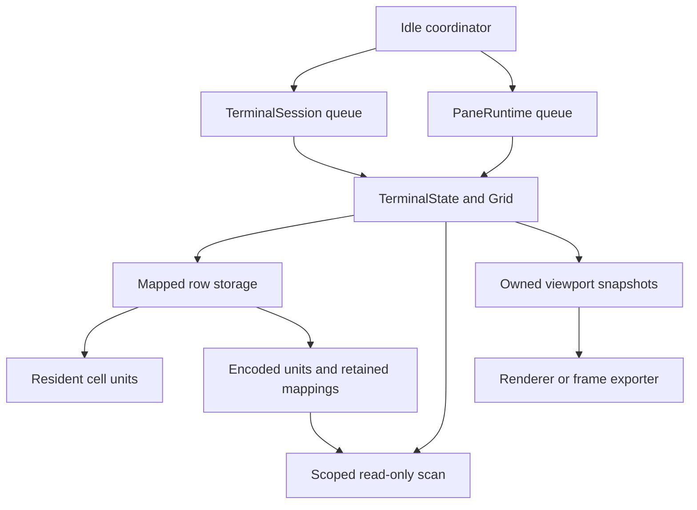
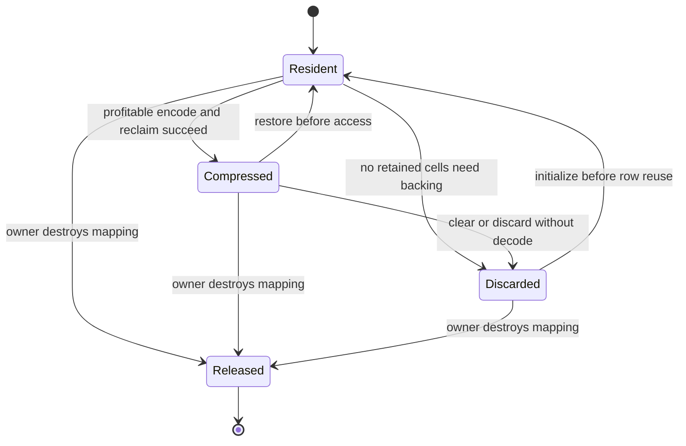

# Spec: Swift-native scrollback compression and memory reclamation

**Repository:** [chr33s/swiftty](https://github.com/chr33s/swiftty)  
**Proposed repository path:** `spec.scrollback.md`  
**Status:** Implemented and enabled on native macOS and iOS/iPadOS (see §17 for deviations and measurements); Catalyst, visionOS and tvOS use the uncompressed fallback  
**Date:** 2026-10-28  
**Baseline:** [`5eef5ae58e2c62aa305a0f9befbaeb3c5b6204aa`](https://github.com/chr33s/swiftty/commit/5eef5ae58e2c62aa305a0f9befbaeb3c5b6204aa), the inspected `main` revision  
**Reference:** [Ghostty 1.4 scrollback compression and lower memory usage][G01]

## 1. Decision and intended outcome

Evolve Swiftty's existing Swift-native scrollback into a reclaimable, optionally compressed page store inside `SwifttyEngine`. Preserve its terminal semantics, noncopyable ownership model, physical row IDs, and zero-copy transition from the live screen into history.

The proposed implementation uses Swift for storage ownership, retention, scheduling interfaces, and access rules; Apple's Compression framework for LZ4; and a small Darwin virtual-memory adapter for dedicated page-aligned allocations. It introduces no Ghostty runtime, Zig dependency, second terminal emulator, or persistent transcript.

The user-visible result is lower memory consumption after output becomes idle, with the same retained text, colors, Unicode clusters, selection, prompt navigation, and search results. Clearing scrollback should release eligible physical backing instead of retaining the previous high-water allocation.

The initial release keeps existing retention defaults. A larger default history is a separate product decision after measurements, because compressed history may become resident again during output, scrolling, reflow, or grapheme compaction.

### Assumptions

- “Swift native” means the authoritative buffer and integration remain in the Swift engine. Calling Apple's system compression and memory APIs is acceptable.
- This work is a specification for the current repository, not an implementation or a request to replace the parser or renderer.
- Initial compression enablement targets the native macOS runtime. Other Apple products must continue to build and behave correctly through an explicit uncompressed fallback until device measurements validate enablement.
- Existing SwiftMux and RST/1 capabilities remain the product boundary. Storage improvements do not add remote history browsing to a screen-only protocol.
- The implementation is in-memory only. It does not add session restoration, history files, or cloud synchronization.

## 2. What the repository already does

Swiftty already contains a native scrollback implementation. The main gaps are physical reclamation, cold storage, and the access contracts needed to introduce them safely.

| Area | Observed behavior at the baseline | Consequence for this change |
| --- | --- | --- |
| Engine | `SwifttyEngine` owns parser, terminal state, history, and PTYs; it has no Metal, font, or AppKit dependency. | Storage belongs here so headless panes benefit. |
| History ring | `Scrollback` is a noncopyable, oldest-first ring of `Int32` physical row IDs. A full ring recycles the oldest row. | Retain chronological ordering and stable row identity. |
| Cell allocation | `GridStorage` lazily allocates cells in chunks of 64 rows. Several metadata arrays are allocated to capacity up front. | Do not describe current cell storage as fully eager. Preserve lazy growth and improve its reclamation. |
| Clearing | `clearHistory()` blanks retained row extents and recycles IDs, but keeps allocated cell chunks. | Add discard paths that release backing without decoding history first. |
| Cells | `Cell` is `BitwiseCopyable`, with a current 16-byte stride and packed attributes. | A process-local cell-byte representation is possible; Swift object graphs must remain outside it. |
| Public views | History and viewport methods return lifetime-bound `Span<Cell>` views and currently document O(1), allocation-free access. | Preserve lifetime safety; explicitly revise the cold-read complexity contract. |
| Rendering | Visible cells and graphemes are copied into owned snapshots or `OwnedScreen`. | Retained frames must remain independent of history storage. |
| Reflow and graphemes | Reflow materializes arrays; grapheme compaction rewrites IDs across both grids and history. | History is not permanently immutable. These operations need explicit cold-page handling. |

Evidence: [package layout][R01], [ring][R02], [storage][R03], [grid access and scrolling][R04], [cell layout][R05], [viewport API][R06], [owned frames][R07], [reflow][R08], [grapheme compaction][R09], and [embedding contracts][R10].

### 2.1 Existing retention semantics

For the current terminal width:

```text
rowBytes = columns × MemoryLayout<Cell>.stride

historyRows =
  historyLimitBytes <= 0
    ? 0
    : min(max(0, maxHistoryRows),
          max(1, historyLimitBytes / rowBytes))
```

Preserve this formula in the initial release, including its positive-budget minimum of one row. All multiplication, division inputs, page rounding, and capacity conversions must use checked arithmetic.

The byte budget counts uncompressed history **cell payload**. It does not include the active screen, row metadata, grapheme/hyperlink tables, allocation rounding, compression workspace, snapshots, or total process memory. Rows mean physical display rows at the current width, including soft-wrapped rows. Compression must not change eviction decisions. [R03] [R11]

| Context | Current default or cap to preserve |
| --- | --- |
| Direct terminal / ordinary SSH emulator | 10,000,000 decimal bytes; 100,000 history rows |
| Standard SwiftMux pane limits | Up to 16 MiB and 10,000 rows per pane |
| Standard SwiftMux service history pool | 128 MiB of logical pane budgets, with existing future-pane reservations |
| Presentation-only terminal session | History disabled |

SwiftMux admission uses logical committed history budgets, not current resident memory. Compressed bytes do not create additional budget for another pane. [R12] [R13] [R14]

### 2.2 State owners and client paths

| Path | Authoritative state owner | Scope |
| --- | --- | --- |
| Direct local PTY | `TerminalSession.queue` | Full buffer, scrolling, copy, and search |
| Ordinary SSH byte stream | Local `TerminalSession.queue` | Same local emulator and history behavior |
| SwiftMux native frontend | Per-pane `PaneRuntime.queue` | Pane history and independent viewer windows/search |
| RST/1 roaming presentation client | Receives owned active-screen snapshots | Client history/search remain disabled |
| Roaming host | Uses SwiftMux's authoritative pane | Benefits from lower pane memory without a protocol change |

`MuxService.queue` does not own a pane's terminal state. Storage operations must run on the per-pane queue. The RST exporter reads the active grid; it does not export the full scrollback or the controller's historical viewport. [R14] [R15] [R16] [R17]

## 3. What to take from Ghostty 1.4

Ghostty provides the architectural reference: explicit LZ4 encoding of cold pages, retained virtual mappings, physical backing reclamation, and on-demand restoration. Its compression work is incremental and idle-driven; preserved reads avoid restoring every page during search. [G02] [G03]

On Darwin, the reference uses `MADV_FREE_REUSABLE` and `MADV_FREE_REUSE`. These are reclamation/accounting primitives, not the codec. A successful reclaim means raw bytes must no longer be trusted, even if the OS has not physically discarded them yet. [G04]

Ghostty reports 70–90% savings for compressed text-heavy pages and raises its default limit to 50 MB. These are upstream observations, not Swiftty results. Its byte-limit semantics also differ: Ghostty counts logical terminal-page allocation including the active screen. Swiftty's existing history-cell accounting remains authoritative here. [G01] [G05]

Do not import unrelated Ghostty results as acceptance evidence. Smaller empty-terminal allocations, GPU resource release, parser throughput, and PTY threading are separate changes.

### Alternatives considered

| Option | Assessment |
| --- | --- |
| Rely only on macOS automatic memory compression | Does not provide explicit cold-history policy, reproducible accounting, or clear-history reclamation behavior. |
| Encode strings or ANSI transcripts | Loses or reconstructs terminal cell semantics and adds a second source of truth. |
| Evicting decode cache behind existing row-pointer APIs | Can invalidate earlier borrowed rows while another row is read. Requires a larger public API migration. |
| New page-local terminal representation with its own grapheme tables | Promising later, but substantially broadens the change and increases parity risk. |
| Stable mapped cells with explicit LZ4 and scoped scan buffers | Selected: retains current addressing and borrowing while introducing bounded cold storage. |

## 4. Requirements

### Functional requirements

1. Compression on and off produce identical retained rows, cell attributes, wrapping, semantic marks, cursor state, selection text, search matches, and exported viewport metadata.
2. Oldest-first eviction and existing byte/row limits remain independent of compression ratio.
3. Live screen cells are always resident before parser or renderer access.
4. Only historical backing that is not needed by the current protected read/viewport set is eligible for compression.
5. Compression, restoration, and reclamation do not change semantic damage, terminal revision, `addressingGeneration`, search generation, or SwiftMux `changeCount`.
6. Borrowed views remain valid until the owner is mutated, as documented.
7. Engine-owned full-history scan helpers and migrated consumers use bounded decoded storage and do not permanently restore the entire history. External callers deliberately borrowing every row through the public promoting API are outside this bounded-scan guarantee.
8. Clearing history can discard compressed contents without decoding them.
9. Grapheme IDs, OSC 8 references, underline-color references, and OSC 133 marks remain valid across every storage transition.
10. Both direct sessions and headless panes schedule maintenance; presentation-only sessions schedule none.
11. Every scheduled operation becomes inert after owner teardown or a relevant storage-generation change.
12. Unsupported platforms or optional compression failures continue with valid uncompressed storage.

### Exclusions

This specification does not add unlimited history, disk spilling, durable scrollback, a new terminal engine, renderer/GPU reclamation, a new RST history protocol, or a default increase to 50 MB. It does not claim constant-memory resize or eliminate all existing Unicode-table costs.

## 5. Architecture



Use the existing noncopyable `Grid` and `Scrollback` facade. Add a private storage layer below physical-row access so consumers cannot bypass residency checks accidentally. Ordinary screen access must retain a small resident-only fast path after residency has been established.

### Proposed components

| Component | Responsibility |
| --- | --- |
| `MappedCellChunk` | Own a dedicated anonymous mapping for one logical 64-row chunk; unmap exactly once |
| `ScrollbackUnit` | Describe a bounded independently encoded subrange of a chunk |
| `ScrollbackCodec` | Buffer encode/decode through Apple Compression; validate lengths and codec results |
| `ScrollbackMemory` | Checked page rounding, mapping, reclamation, reuse, and teardown |
| `HistoryScan` | Nonescaping cell-segment traversal with owned scratch for compressed input |
| `ScrollbackMaintenance` | Eligibility, bounded scan cursor, activity/storage generations, counters |
| `ScrollbackMaintenanceCoordinator` | Fair process-wide dispatch of small requests to registered owners |
| Owner adapters | Register, report activity, apply policy, and execute maintenance on the correct queue |

Names are proposed implementation names. They are not existing repository APIs.

## 6. Storage representation and state transitions

### 6.1 Preserve physical addressing

Keep physical row IDs and the logical 64-row chunk index calculation. Moving a row from screen to history still rotates IDs; it does not serialize a row or allocate a per-row object. Existing pointer-identity coverage remains relevant. [R02] [R04] [R18]

For the mapped backend:

- Reserve each chunk with a dedicated anonymous mapping rounded to the runtime VM page size.
- Initialize rows when they enter use. Do not touch every future row simply to populate a free list.
- Preserve the mapping's address while any live row ID refers to it.
- Never call `madvise` on normal Swift heap allocations, `Array` storage, or buffers whose VM pages may contain unrelated objects.
- Keep row ownership, wrapped flags, marks, extents, ring counters, and descriptors outside reclaimable cell memory.

The fallback backend may retain existing heap chunks. It must never enter the mapped reclamation path.

### 6.2 Bound codec work independently of terminal width

A 64-row chunk grows with the column count. At a 16-byte cell stride, 256 columns already make a 256 KiB chunk. Rejecting all larger chunks would disable compression for ordinary wide terminals.

Keep the logical chunk mapping, but divide its backing into **VM-page-aligned compression units no larger than 256 KiB**. Round the unit size down to a positive multiple of the runtime VM page size. If this cannot be satisfied on a platform, disable that backend.

A row may intersect more than one unit:

- Row access restores every intersecting unit before returning its contiguous span.
- Live-row protection covers every unit the row touches.
- A unit containing any active-screen row is ineligible.
- Units intersecting free or not-yet-initialized logical rows are ineligible for compression. Fully free units may be discarded; mixed units preserve backing required by retained rows. Trailing mapping padding beyond usable capacity is excluded from logical ownership.
- Scan access yields bounded cell segments plus row/column metadata, not an unbounded copied row.
- Encoding covers only initialized payload and defined padding. Restore reconstructs the exact accessible cell bytes.

Maintain per-unit occupancy/protection summaries so candidate checks do not scan the entire history. Update summaries when row ownership changes. The common narrow-row path should require one unit check; unusually wide rows pay for the units they intersect.

### 6.3 Descriptor and payload rules

Each unit descriptor contains its stable identity, reuse generation, mapping offset, mapped length, usable cell range, state, encoded byte count, a CRC-32C checksum over the normalized decoded payload, and the content/table epoch needed to validate the encoded representation. Track recent access and an incompressible-at-this-generation marker.

Use `COMPRESSION_LZ4` for the first implementation. Apple's buffer API provides caller-supplied scratch; a zero encode result is failure or insufficient destination capacity, not an empty successful stream. Its framed format is a local implementation detail, not Ghostty wire compatibility. [A01] [A02]

Encode only `Cell` payload with a verified bitwise-copyable layout. Normalize padding or encode defined fields into zero-initialized scratch before compression; do not depend on indeterminate padding. Validate stride/layout assumptions in tests. Never compress raw `String`, `Array`, `Data`, class, or ARC-managed object representations.

Compute the checksum before discarding resident backing and verify it after every decode, including preserved scans, before exposing cells. Codec success and the expected output length alone do not establish byte integrity. Include checksum work in the latency and throughput gates. This is an accidental-corruption check, not cryptographic authentication.

The representation is process-local and temporary. It has no persisted ABI, endianness promise, or decoder for externally supplied files.

### 6.4 State machine



**Resident:** raw mapping is authoritative. No encoded blob may be reused after content changes.

**Compressed:** the validated encoded representation is authoritative; the raw mapping remains reserved but must not be read.

**Discarded:** no retained content depends on the old bytes. A future allocation initializes valid blank cells before exposure.

**Released:** both mapping and encoded ownership have ended.

Retain compressed form only when encoded allocation plus its representation overhead is smaller than the backing it replaces. Include allocator rounding in instrumentation. Unprofitable units remain resident and are not retried until their content or eligibility changes.

Commit compression only after the encoded copy is complete and reclamation has succeeded. If reclamation can partially affect a failed range, restore from the completed encoded copy before returning to the resident state.

Restoration must validate the expected decoded byte count before exposing a pointer. Release the unit's encoded allocation after successful restoration; this avoids keeping two authoritative copies.

## 7. Access, borrowing, and scan contracts

### 7.1 Normal borrowed reads: promotion only

Preserve the public return shape of `Grid.historyCells(at:)`, `TerminalState.scrollbackCells(at:)`, and viewport cell access.

A cold read may restore its requested units **in place** through controlled private interior storage mutation. During a borrowed read it may never:

- Demote another unit.
- Unmap or relocate cell memory.
- Recycle a row ID.
- Change retained terminal content or address generations.
- Expose a pointer to scratch that a subsequent read overwrites.

This monotonic promotion rule allows two borrowed rows to coexist: reading the second row cannot invalidate the first. Releasing the successfully restored unit's obsolete encoded blob is permitted; releasing its cell mapping is not.

Compression and reclamation require exclusive owner access after borrows end. Normal engine objects remain thread-confined. A nonmutating method that can restore residency is not a promise of concurrent-reader safety.

Update public documentation consistently:

- Warm row lookup: O(1) for the common one-unit row; no Swiftty heap allocation.
- Cold row lookup: O(total bytes of intersecting cold units), plus VM page commitment.
- Cold restoration uses preallocated codec resources where required; zero malloc calls do not imply zero memory cost or zero kernel work.

The live parser's raw pointer helpers must assert/prove residency after activation. Audit every route into `physical`, `_unsafeRow`, mutable history access, and row writing. No raw pointer may cross an owner-queue boundary or outlive its scoped borrow.

### 7.2 Read-only scans: do not change source residency

Add a scoped iterator that can decode one unit at a time into owned reusable scratch. Permit a second scratch unit for bounded overlap or adjacent-unit processing. Scratch views cannot escape their callback or remain in an array.

Carry row identity, column offset, extent, wrap flag, and semantic marks separately from the cell segment. Consumers must preserve partial logical-line, Unicode, and match state across unit boundaries.

The decoded working set for an engine-owned scan is at most two compression units plus codec workspace. This is separate from legitimate result memory, such as the copied selection string or the list of search matches. An embedding caller can intentionally restore all history through repeated public borrowed reads; preserving those borrows takes precedence, and reclamation waits for subsequent exclusive maintenance.

Migrate these consumers before automatic compression is enabled:

| Consumer | Required behavior |
| --- | --- |
| Search and active-search refresh | Preserve matches across soft wraps and unit boundaries; leave scanned source compressed |
| Selection copy and text formatting | Stream decoded cells; preserve existing newline, rectangle, wide-cell, and trimming rules |
| ANSI/plain dump | Remove the current array of pointers covering all history; stream scoped segments |
| OSC 8 reachability/reclamation | Scan compressed history without promoting it, including inactive primary history |
| URL detection | Preserve logical-line text and offsets across compressed segments |
| Wrap-only shell/selection traversal | Read resident metadata without decoding cells |
| Full invariant checks | Inspect through scratch so checking does not alter residency under test |
| Reflow source collection | Use preserved reads even though the existing reflow result still materializes arrays |

The current dump and hyperlink routines are particularly important: substituting a reusable scratch pointer into an array of retained pointers is invalid, and letting OSC 8 scans use ordinary promoting reads can inflate all history during output. [R19] [R20] [R21]

### 7.3 Viewports, snapshots, and multiple viewers

Protect the active primary and alternate screen units at all times. For a capture, protect/restore the requested viewport and overscan for the duration of that owner-queue operation. The resulting `RenderSnapshot` or `OwnedScreen` owns its cells and graphemes; it does not pin the source mapping after capture. [R07] [R22]

For direct sessions, keep the current viewport and a bounded recent-access window warm. For SwiftMux, apply the same rule to captures from independent viewers. A completed immutable frame can stay displayed while its source history becomes cold.

Do not permanently pin every viewer's historical range. Bound extra recent-view protection to eight units per owner, excluding units required by live screens and the current capture. Use recency to choose among additional ranges; this is a compression policy, not history eviction. Report protected bytes so many-viewer cases cannot hide behind a low eligibility denominator.

Compression/restoration alone must not call `publish()` or `noteChange()`, redraw a view, or invalidate a viewer's cached search result. Existing controller/observer viewport restoration must remain intact. [R14] [R15]

## 8. Mutation and lifecycle behavior

### 8.1 Output and row recycling

A ring eviction can recycle a row whose storage is compressed. Restore the units intersecting that row before clearing or writing it, because neighboring retained rows may share the same unit.

Invalidate any stale encoded copy before the first cell write. This applies to parser writes, mutable spans, row replacement, grapheme remapping, and reflow.

Keep units containing the next eviction horizon of up to 64 history rows warm where practical. This reduces the first resume cost but does not eliminate restoration during sustained output. Encoding happens only while idle; decoding can occur on the parser path. Measure both cold restart and warmed steady state.

Partial scroll regions, insertion/deletion, BCE erase colors, wide-cell pairs, and alternate-screen behavior must match the baseline exactly. Compression does not redefine which rows enter history. [R04] [R09]

### 8.2 Clear, trim, reset, and teardown

For a clear:

1. Invalidate pending maintenance generations.
2. Remove history row ownership and reset existing history/selection/addressing state according to current behavior.
3. Discard encoded units whose retained history is gone without decoding.
4. Reclaim fully free resident units; initialize rows lazily on reuse.
5. Preserve live rows in mixed units.
6. Release idle encoding workspace when it is no longer needed, while retaining resources required for any remaining cold reads.

A cold unit that still contains retained rows cannot be discarded merely because one row was evicted. Restore or retain it until all required contents are preserved.

Reset and resize storage replacement invalidate descriptor identities. Teardown cancels registrations and releases all encoded allocations and mappings exactly once. Do not retain the terminal through queued maintenance closures.

### 8.3 Graphemes, hyperlinks, and other shared tables

Keep the existing shared tables for this first release.

Grapheme compaction must visit **every referring cell in both grids and both histories** before publishing a replacement table. The compatibility-first implementation may restore compressed units, rewrite their IDs in place, and leave them resident until the next idle pass. No encoded bytes from the previous table epoch may survive as an authoritative representation. Existing snapshots keep their own grapheme storage. [R09] [R23]

This deliberate exception can temporarily restore the full retained history and hold old/new grapheme tables simultaneously. It is bounded by existing retention and table behavior, not by the two-unit scan workspace. Do not promise a total-process peak equal to the history byte limit.

OSC 8 reclamation uses preserved read-only scans; never recycle a link slot still referenced by compressed cells or a saved cursor. Keep underline-color indices and semantic marks valid under the same existing table lifetimes.

Page-local grapheme tables or lazy ID remapping are future optimizations, not hidden prerequisites for this release.

### 8.4 Resize and reflow

Retain current terminal reflow semantics and generation rules. Read compressed source through the scan interface; do not rewrite the full reflow algorithm in the same change.

Current reflow can simultaneously hold logical-line cells, reflowed output, and rebuilt grid storage. This specification does not make resize constant-memory. Measure its peak separately and prevent accidental additional full-history copies.

Height-only selection preservation, width-change invalidation/remapping, saved cursors, pending wrap, semantic input origins, and alternate-screen resizing must remain covered. [R08] [R24]

## 9. Idle scheduling and platform policy

### 9.1 Owner-driven, bounded maintenance

Provide one process-wide coordinator with weak owner registrations and a single adaptive timer. Each registration holds an owner generation and a next-eligible timestamp, not a cell pointer.

Initial policy values, to be validated by benchmarks:

| Parameter | Proposed initial value |
| --- | --- |
| Idle delay after relevant activity | 250 ms |
| Candidate descriptors examined per step | At most 8 |
| Units encoded per step | At most 1 |
| Maximum unit input | 256 KiB |
| Delay before another pending step | At least 1 ms |
| Concurrent encode steps per process | 1 |
| Extra recent-view protection | At most 8 units per owner |
| Scan decoded workspace | At most 2 units, plus codec scratch |

A request executes on `TerminalSession.queue` or that pane's `PaneRuntime.queue`. It rechecks owner/storage generation, shutdown, policy, activity timestamp, and eligibility immediately before work.

Activity includes received terminal data, input admission, viewport operations, resize, clear, and operations that change history or shared table meaning. Record once per batch, not once per byte or row. Cosmetic rendering and counter inspection must not indefinitely postpone useful work.

Use round-robin fairness among eligible owners. Do not synchronously call from the coordinator into a pane or wait on one queue while holding another. Return only counters and scheduling hints.

The timer stops when no work remains. An incompressible or fully protected history must not cause periodic polling forever. A queued stale request is a cheap no-op after generation mismatch.

Cold promotion and eligibility changes set a coalesced maintenance-dirty signal even when terminal content does not change. After a borrowed read or capture ends, the owner consumes that signal and rearms future eligible work. This covers one-off `withState` reads without triggering semantic publication or a redraw. Standalone engine maintenance remains explicitly caller-driven; terminal state objects do not create timers themselves.

The codec call itself is not preemptible. One bounded unit limits the amount of work but does not guarantee a hard wall-clock deadline. Record execution duration and queue wait separately.

### 9.2 Platform rollout

Enable automatic compression first on validated native macOS builds. The engine API exposes requested and effective policy plus a diagnostic reason for fallback.

Other Apple targets compile with a valid uncompressed backend. Enable mapped compression on iOS, iPadOS, Catalyst, visionOS, or tvOS only after checking platform API support, memory accounting, lifecycle behavior, and representative device latency/energy. Do not add a background execution entitlement or compression work while an app is suspended.

The watch companion remains outside the terminal engine dependency graph. Linux support is not part of the current package's product promise. [R01]

On memory pressure, first release reclaimable free backing and idle workspace. Do not run an unbounded emergency encode pass or silently reduce the configured retained history. A later app-level retention policy would be a separate decision.

## 10. Configuration and compatibility

Add canonical Ghostty-style names while preserving Swiftty's finite retention semantics.

| Setting | Proposed behavior |
| --- | --- |
| `scrollback-limit` | Existing byte-limit alias; remains accepted |
| `scrollback-limit-bytes` | New canonical alias for the same logical history-cell budget |
| `scrollback-limit-lines` | New finite physical-row limit; default 100,000 for direct sessions |
| `scrollback-compression` | New boolean; default requested `true`, effective only on validated supported backends |

Example:

```ini
scrollback-limit-bytes = 10000000
scrollback-limit-lines = 100000
scrollback-compression = true
```

Rules:

- Old and new byte keys write the same field in normal configuration/include order; the last valid assignment wins. Do not invent a separate priority rule.
- Zero bytes or zero lines disables history. Preserve programmatic nonpositive-limit behavior.
- Negative config-file numbers, overflow, and `unlimited` are diagnosed and ignored under the existing invalid-value policy; they must not become zero silently.
- Empty-value reset follows the existing configuration mechanism for the canonical field.
- Keep the public `Configuration.scrollbackLimit` property compatible; add row/compression fields and map them into `SessionConfiguration`.
- Retention limits apply when a terminal/pane is created; resize recomputes physical capacity from the same configured budgets. This feature does not introduce retroactive resizing of existing retention.
- A live compression toggle may stop or resume maintenance. Turning it off does not eagerly decode existing history; those pages remain readable and restore on demand.
- SwiftMux service limits and pane admission stay authoritative. Add compression policy through local `MuxServiceConfiguration` and `PaneRuntime`, rather than changing `MuxLimits` or SMX wire messages.
- Presentation-only sessions force history off and cannot arm maintenance.

The new aliases and boolean do not exist in the inspected config parser. They are proposed additions, not existing compatibility. [R11] [R12] [R25]

## 11. Accounting, failures, and invariants

### 11.1 Report distinct memory quantities

| Counter | Meaning |
| --- | --- |
| `logicalHistoryCellBytes` | Retained row count × columns × cell stride |
| `reservedMappingBytes` | Virtual address space retained by mapped chunks |
| `residentUnitBytes` | Backing considered resident by the store; not a substitute for OS RSS |
| `compressedPayloadBytes` | Encoded payload plus allocator capacity/rounding |
| `metadataBytes` | Ring, row, descriptor, and protection metadata |
| `workspaceBytes` | Encode, decode, and scan scratch currently retained |
| `protectedUnitBytes` | Backing excluded by live screens/current/recent captures |
| `eligibleUnitBytes` | Actual cold candidates at a specified sample |
| `reclaimedFreeBytes` | Successfully reclaimed backing with no retained content |
| Restore/compress counts and durations | Work by reason: viewport, recycle, scan, compaction, or other |

Also sample current process resident memory and physical footprint through supported platform APIs. Keep peak RSS separate. The current benchmark's `getrusage().ru_maxrss` cannot demonstrate that memory falls after compression or clear. [R26]

Counter collection must be metadata-only. Reading diagnostics must not restore compressed history.

### 11.2 Failure policy

| Failure | Required result |
| --- | --- |
| Unsupported backend | Valid uncompressed operation; effective policy reports fallback |
| Optional workspace or encoded allocation unavailable | Skip the attempt; keep resident source |
| Encode returns zero or is unprofitable | Keep resident source; avoid repeated attempts for the same unchanged unit |
| Reclamation fails before cold state is committed | Return to a verified resident state; retain/restore from encoded source as necessary |
| Candidate becomes stale before execution | Do nothing; never commit into a reused descriptor |
| Decode length/integrity failure after cold state committed | Internal storage invariant failure; never expose partial cells, fabricate blanks, or claim a resident fallback still exists |
| Ordinary history eviction | Apply existing retention/address invalidation rules; no error |

The existing public borrowed accessors are infallible. Therefore the initial implementation treats unexpected committed-payload corruption as a fail-fast internal invariant violation. It must be explicitly tested below the facade and documented; per-pane graceful recovery would require an error-capable access boundary and is not silently assumed here.

Restore resources needed by an already-compressed unit must remain available. Do not publish a cold state whose later restoration depends on allocating a new full-size Swift buffer. Physical page commitment is still an OS operation and can carry memory-pressure costs.

### 11.3 Core invariants

- Each allocated physical row has exactly one logical owner: screen, history, or free pool.
- All active-screen units are resident.
- No valid borrowed cell pointer references a compressed/discarded unit.
- Free or not-yet-initialized rows are checked through ownership metadata; invariant checks do not interpret their untouched bytes as initialized `Cell` values. Reuse initializes them before any public access.
- A compressed payload matches its unit content and table epochs.
- Metadata-only access never decodes cells.
- A scan cannot return scratch ownership to an escaping caller.
- Compression and restoration do not change terminal content or coordinates.
- Destroyed/reused storage cannot accept a stale maintenance action.
- Compression cannot increase logical retention or bypass the service budget.
- No clearing path decodes a unit solely to discard its contents.

## 12. Source changes and code conventions

Keep new storage internals in the engine. Avoid a general storage framework or dependencies unrelated to this feature.

| Existing area | Required integration |
| --- | --- |
| `Sources/SwifttyEngine/Terminal/GridStorage.swift` | Mapping ownership, unit descriptors, lazy initialization, clear/reclaim paths |
| `Scrollback.swift`, `Grid.swift` | Preserve ring/row semantics; resolve residency on read, write, and recycled-row activation |
| New terminal storage files | `MappedCellChunk.swift`, `ScrollbackMemory.swift`, `ScrollbackCodec.swift`, `HistoryScan.swift`, `ScrollbackMaintenance.swift` |
| `TerminalState+Viewport.swift`, `Selection.swift`, `Links.swift`, `Dump.swift` | Correct cold reads, scoped scans, and metadata-only traversal |
| `TerminalState+OSC.swift`, `TerminalState+Shell.swift` | Hyperlink reachability and wrap-only access |
| `TerminalState.swift`, `TerminalReflow.swift`, invariant checks | Shared-table epochs, reflow reads, full cold-state verification |
| `SessionConfiguration.swift`, core `Configuration.swift` | Policy and finite config aliases |
| `SwifttyCore/Session/TerminalSession.swift` | Direct-owner maintenance lifecycle |
| `SwiftMuxService/PaneRuntime.swift`, `Model.swift`, `MuxService+Panes.swift` | Headless-owner policy and scheduling without wire changes |
| `SnapshotBuilder.swift`, `SnapshotStorage.swift`, engine `OwnedScreen.swift` | Viewport protection, immutable copied frames |
| `Sources/SwifttyBench` and existing test targets | New storage-state metrics, transitions, and replay coverage |
| `README.md`, `spec.md` | Public warm/cold read costs, configuration, measurement evidence |

Use Swift 6.4 ownership/lifetime features already enabled by the package. Use `~Copyable` for unique mapping owners, scoped `Span` views, checked integer math, and package/private declarations for implementation details. Retain two-space indentation and existing formatter rules. [R01] [R10]

Illustrative style for a value-only maintenance configuration:

```swift
package struct ScrollbackMaintenanceBudget: Sendable {
  package var maximumCandidates = 8
  package var maximumUnits = 1
  package var maximumUnitBytes = 256 * 1024
}
```

The snippet describes proposed configuration shape, not tested implementation code. Unsafe memory and Darwin calls belong behind the storage adapter, with every ownership transition documented.

### Implementation boundaries

**Always:** preserve existing correctness tests; retain owner-queue confinement; validate layout and byte arithmetic; measure live-output behavior; update access-complexity documentation.

**Requires a separate design decision:** persistent history, unlimited budgets, a default retention increase, public throwing row APIs, page-local grapheme IDs, new external dependencies, or SMX/RST protocol changes.

**Never:** compress arbitrary Swift object memory; reclaim shared heap pages; retain scratch pointers; bypass borrowing with unchecked cross-queue pointers; reuse encoded bytes after mutation; drop Unicode/link coverage to make tests pass.

## 13. Verification and release criteria

All performance numbers below are **proposed release targets**, not measurements of this implementation. Pin the exact benchmark build, corpus hashes, Mac model, RAM, OS/Xcode/Swift versions, and thermal/power conditions. The baseline is this document's inspected commit.

### 13.1 Correctness matrix

| Scenario | Required evidence |
| --- | --- |
| Ring/model replay | Extend seeded reference-model tests through compress, restore, discard, clear, reuse, and page-boundary transitions |
| Width boundaries | Exercise 1, 80, 120, 256, 257, and 512 columns; rows crossing compression units; runtime page-size rounding |
| Chunk/ring boundaries | Existing 0, 1, 2, 63, 64, 65 capacities/rows and wrapped ring heads remain covered |
| Retention | Same retained rows and eviction counts with compression on/off, including zero, negative programmatic, one-row, and simultaneous byte/row caps |
| Borrowing | Two borrowed history rows remain valid when later cold reads occur; mutation cannot overlap a valid borrow |
| Snapshots | Retained render snapshots and owned frames remain unchanged through compress/clear/resize/teardown |
| Terminal fidelity | Attributes, BCE, protection, wide leads/tails, spacer padding, soft wrap, alternate screens, and partial regions match |
| Unicode | Combining marks, ZWJ emoji, CJK, cluster-heavy reflow, and compaction across both grids preserve content |
| Selection/search | Cross-unit matches, wrapped text, rectangle copy, trim/eviction, selected occurrence, and addressing generations match |
| OSC integration | Compressed link references survive slot reclamation; prompt/input markers and wrap-only traversal remain correct |
| Multi-view | Controller plus two distant observers scroll/search/capture without state contamination |
| Clear/restart | Clear performs zero cold decodes solely for discarded history; subsequent output starts with valid blank rows |
| Scheduling | Fake-clock tests verify idle delay, one-unit steps, fairness, no perpetual polling, and stale-generation no-ops |
| Failure injection | Encode/allocation/reclaim failure preserves source; corrupt/truncated decoded output is rejected; no partial row escapes |
| Protocol boundaries | SwiftMux frame metadata unchanged; RST presentation remains screen-only; presentation sessions allocate no history |

Use existing Swift Testing suites and their array-model reference approach. Expand `ScrollbackTests`, `StorageLayoutTests`, `StorageBoundsTests`, `SelectionTests`, `GraphemeCompactionTests`, `TerminalReflowTests`, and snapshot tests. Add targeted suites such as `ScrollbackCompressionTests`, `ScrollbackReclamationTests`, and `ScrollbackMaintenanceTests`. [R18] [R23] [R24] [R27]

### 13.2 Allocation and memory criteria

- Existing zero-allocation parser/cell tests continue to pass.
- Add a realistic full-capacity ring test. Existing parser allocation tests often use a one-row history and do not prove full-history reuse behavior. [R28]
- No per-output-row heap allocation after capacity and required restore resources are warmed. Report page-transition allocations separately from row operations.
- For fixed ASCII/compiler-output corpora, target at least 70% reduction in the accounted physical backing cost of eligible cold storage. Include encoded allocation/rounding and attributable metadata/workspace; report the eligible fraction of all history.
- Confirm the direction and practical size of savings with current RSS/physical-footprint samples. A software compressed-byte ratio alone does not pass.
- Read-only full scans leave source units compressed, apart from separately requested displayed results.
- Clearing a filled history removes encoded payloads and reclaims fully free mapped units, returning attributable physical use near the equivalent fresh terminal after bounded maintenance. Report mixed-unit and allocator residuals explicitly.
- Search/copy scratch stays within two units plus codec workspace. Result strings/match lists are measured separately.
- Record resize and grapheme-compaction peaks, including old/new tables, reflow arrays, rebuilt storage, and retained frames. Compare equal retained content with the baseline; no constant-memory claim.
- Many-pane runs report aggregate workspace and current memory, not only per-pane codec ratios.

### 13.3 Throughput and latency criteria

| Metric | Proposed target / acceptance method |
| --- | --- |
| Steady-state output throughput | At least 98% of baseline per representative corpus; investigate results beyond measured run noise |
| Resume into compressed full ring | Same comparison, with restoration included inside the timed interval |
| Idle encode execution | p99 below 1 ms per at-most-256-KiB unit on the named acceptance Mac |
| Cold viewport preparation/capture | Complete storage/capture operation p95 ≤4 ms and p99 ≤8 ms for the fixed 120×80 fixture; report warm distribution separately |
| Typing and frame pacing | Preserve existing no-measurable-regression and display-rate requirements |
| Idle behavior | No repeating wakeups after a completed/no-work pass; no redraw triggered solely by compression |

Use at least five alternating baseline/candidate throughput runs and report spread. For p99 interaction data, collect at least 1,000 comparable samples. Do not subtract unrelated p99 values and label the result added latency. Warm glyph/font caches for storage-only latency; measure end-to-end input/render separately.

A one-unit byte bound is not a real-time scheduling guarantee. Record queue delay as well as execution. If a platform misses these targets, keep automatic compression off there pending tuning; do not present the thresholds as proven universal guarantees.

The existing upstream-Ghostty parser comparison requirements remain in force: ≥95% for each comparison input, or ≥90% for wide-character-heavy inputs. This feature does not replace those repository gates. [R29]

### 13.4 Required benchmark stages and workloads

Capture these stages within one process with equal retained rows: empty → filled → idle-compressed → cold-scroll → full-search/copy → resumed-output → resized → cleared → closed.

Include:

- ASCII, compiler logs, source files, CSI/OSC-heavy output, and full redraws.
- Styled text, dense OSC 8 links, CJK, combining marks, and emoji.
- Long logical lines crossing multiple units.
- Incompressible/randomized cell patterns.
- Continuous output, then long idle, then immediate output beyond one full history capacity.
- One pane, many idle panes, and many panes resuming together.
- A controller at live output with two observers at distant historical ranges.
- Compression enabled/disabled at identical history limits.
- Native macOS and uncompressed fallback builds; physical iPad evidence before mobile enablement.

Add explicit `scrollback-memory`, `scrollback-compression`, and `scrollback-resume` benchmark cases to the existing executable. These case names are new work, not current CLI options.

## 14. Commands and environment

The inspected package uses Swift tools 6.4, a `mise` pin of Swift 6.4.1, and Apple platform deployment declarations at 27.0. Use the repository's supported Mac/Xcode environment. The commands below were checked against source; they were not executed during specification writing. [R01] [R30]

### Existing build and verification commands

```bash
mise install
swift build -c release

Scripts/test-native.sh
Scripts/test-native.sh -c release
Scripts/test-native.sh -Xswiftc -DSWIFTTY_INTERNAL_CHECKS

mise run lint
mise run format-check

swift run -c release swiftty-bench --mb 100 --repeat 5 --only ascii,utf8,utf8-cjk,compiler-log,cat-source,csi-heavy,osc-heavy
swift run -c release swiftty-bench --only storage,scroll,scroll-frames,resize,latency

swift run -c release swiftty
```

Use `Scripts/test-native.sh` for the full acceptance suite. It hosts and audits each test bundle; plain `swift test` is not a substitute for the repository's AppKit/native-host completion checks. Its arguments are Swift build options plus `--skip-build`; do not add an invented test-name filter. [R31]

### Existing cross-platform build checks

```bash
xcodebuild -scheme SwifttyMobile -configuration Release -destination 'generic/platform=iOS Simulator' CODE_SIGNING_ALLOWED=NO build

xcodebuild -scheme SwifttyMobile -configuration Release -destination 'generic/platform=macOS,variant=Mac Catalyst' CODE_SIGNING_ALLOWED=NO build

xcodebuild -scheme SwifttyMobile -configuration Release -destination 'generic/platform=visionOS Simulator' CODE_SIGNING_ALLOWED=NO build
```

Run the repository's remaining platform/hosted checks appropriate to touched targets. Simulator compilation does not establish device memory or energy behavior.

### Proposed command after the new benchmark cases exist

```bash
swift run -c release swiftty-bench --repeat 5 --only scrollback-memory,scrollback-compression,scrollback-resume
```

The new cases must expose fixed corpora and compression on/off variants in their output so the results are reproducible. Record current memory stages separately from peak RSS.

## 15. Delivery checkpoints and decisions to validate

These are acceptance checkpoints within this specification, not a claim that implementation has started.

| Checkpoint | Reviewable result |
| --- | --- |
| Storage boundary | Existing behavior and pointer/lifetime tests pass with the new access boundary and compression disabled |
| Reclaimable allocation | Lazy mappings, clear-without-decode, and free-unit reclamation pass failure and ownership tests |
| Explicit cold storage | Test-driven encode/restore and preserved scans work; every reader/mutator is audited |
| Owner integration | Direct and headless queues schedule bounded work; no protocol or semantic notification changes |
| Default enablement | Correctness, current-memory measurements, cold-restart throughput, and latency gates pass on the named Mac |
| Additional platforms | Device/lifecycle evidence justifies enabling each backend separately |

Before default enablement, record the acceptance Mac and measured page sizes, confirm the framed LZ4 choice against a representative corpus, and verify scratch/encoded allocation overhead at many-pane scale. These are measurement decisions; the storage architecture and compatibility requirements above do not depend on guessing their results.

A change to fail-fast corruption handling, retention accounting, public API shape, or protocol scope requires updating this specification before implementation proceeds with that alternative.

## 16. Source register

Repository references are pinned to the inspected commit. External behavior was reviewed on 2026-10-28. Source findings are distinguished from proposed behavior throughout this document.

[R01]: https://github.com/chr33s/swiftty/blob/5eef5ae58e2c62aa305a0f9befbaeb3c5b6204aa/Package.swift "Package targets, Swift settings, and deployment declarations"
[R02]: https://github.com/chr33s/swiftty/blob/5eef5ae58e2c62aa305a0f9befbaeb3c5b6204aa/Sources/SwifttyEngine/Terminal/Scrollback.swift "Current row-ID ring"
[R03]: https://github.com/chr33s/swiftty/blob/5eef5ae58e2c62aa305a0f9befbaeb3c5b6204aa/Sources/SwifttyEngine/Terminal/GridStorage.swift "Allocation, limits, clearing, and invariants"
[R04]: https://github.com/chr33s/swiftty/blob/5eef5ae58e2c62aa305a0f9befbaeb3c5b6204aa/Sources/SwifttyEngine/Terminal/Grid.swift "Borrowed rows, recycling, and mutation"
[R05]: https://github.com/chr33s/swiftty/blob/5eef5ae58e2c62aa305a0f9befbaeb3c5b6204aa/Sources/SwifttyEngine/Terminal/Cell.swift "Bitwise-copyable cell representation"
[R06]: https://github.com/chr33s/swiftty/blob/5eef5ae58e2c62aa305a0f9befbaeb3c5b6204aa/Sources/SwifttyEngine/Terminal/TerminalState%2BViewport.swift "Viewport and scrollback access"
[R07]: https://github.com/chr33s/swiftty/blob/5eef5ae58e2c62aa305a0f9befbaeb3c5b6204aa/Sources/SwifttyEngine/Terminal/OwnedScreen.swift "Owned frame capture"
[R08]: https://github.com/chr33s/swiftty/blob/5eef5ae58e2c62aa305a0f9befbaeb3c5b6204aa/Sources/SwifttyEngine/Terminal/TerminalReflow.swift "Reflow materialization and commit"
[R09]: https://github.com/chr33s/swiftty/blob/5eef5ae58e2c62aa305a0f9befbaeb3c5b6204aa/Sources/SwifttyEngine/Terminal/TerminalState.swift "Terminal state and grapheme compaction"
[R10]: https://github.com/chr33s/swiftty/blob/5eef5ae58e2c62aa305a0f9befbaeb3c5b6204aa/README.md#api-and-storage-contracts "Public ownership and formatting contracts"
[R11]: https://github.com/chr33s/swiftty/blob/5eef5ae58e2c62aa305a0f9befbaeb3c5b6204aa/Sources/SwifttyEngine/Session/SessionConfiguration.swift "Direct-session defaults"
[R12]: https://github.com/chr33s/swiftty/blob/5eef5ae58e2c62aa305a0f9befbaeb3c5b6204aa/Sources/SwiftMuxProtocol/Limits.swift "SwiftMux limits"
[R13]: https://github.com/chr33s/swiftty/blob/5eef5ae58e2c62aa305a0f9befbaeb3c5b6204aa/Sources/SwiftMuxService/MuxService%2BPanes.swift "Logical service budget admission"
[R14]: https://github.com/chr33s/swiftty/blob/5eef5ae58e2c62aa305a0f9befbaeb3c5b6204aa/Sources/SwifttyCore/Session/TerminalSession.swift "Direct owner and presentation-only construction"
[R15]: https://github.com/chr33s/swiftty/blob/5eef5ae58e2c62aa305a0f9befbaeb3c5b6204aa/Sources/SwiftMuxService/PaneRuntime.swift "Headless owner, observer viewports, and search"
[R16]: https://github.com/chr33s/swiftty/blob/5eef5ae58e2c62aa305a0f9befbaeb3c5b6204aa/Sources/TerminalHost/ScreenExporter.swift "Active-screen RST export"
[R17]: https://github.com/chr33s/swiftty/blob/5eef5ae58e2c62aa305a0f9befbaeb3c5b6204aa/Sources/SwifttyEngine/Session/PresentationFrame.swift "Surface capability profiles"
[R18]: https://github.com/chr33s/swiftty/blob/5eef5ae58e2c62aa305a0f9befbaeb3c5b6204aa/Tests/SwifttyCoreTests/ScrollbackTests.swift "Pointer identity, bounds, and ring reuse tests"
[R19]: https://github.com/chr33s/swiftty/blob/5eef5ae58e2c62aa305a0f9befbaeb3c5b6204aa/Sources/SwifttyEngine/Terminal/Dump.swift "Current dump pointer collection"
[R20]: https://github.com/chr33s/swiftty/blob/5eef5ae58e2c62aa305a0f9befbaeb3c5b6204aa/Sources/SwifttyEngine/Terminal/TerminalState%2BOSC.swift "Hyperlink reachability"
[R21]: https://github.com/chr33s/swiftty/blob/5eef5ae58e2c62aa305a0f9befbaeb3c5b6204aa/Sources/SwifttyEngine/Terminal/Selection.swift "Selection, search, and absolute addressing"
[R22]: https://github.com/chr33s/swiftty/blob/5eef5ae58e2c62aa305a0f9befbaeb3c5b6204aa/Sources/SwifttyCore/Renderer/SnapshotStorage.swift "Snapshot-owned cells and graphemes"
[R23]: https://github.com/chr33s/swiftty/blob/5eef5ae58e2c62aa305a0f9befbaeb3c5b6204aa/Tests/SwifttyCoreTests/GraphemeCompactionTests.swift "Compaction parity"
[R24]: https://github.com/chr33s/swiftty/blob/5eef5ae58e2c62aa305a0f9befbaeb3c5b6204aa/Tests/SwifttyCoreTests/TerminalReflowTests.swift "Reflow parity"
[R25]: https://github.com/chr33s/swiftty/blob/5eef5ae58e2c62aa305a0f9befbaeb3c5b6204aa/Sources/SwifttyCore/Config/Configuration.swift "Current config parsing"
[R26]: https://github.com/chr33s/swiftty/blob/5eef5ae58e2c62aa305a0f9befbaeb3c5b6204aa/Sources/SwifttyBench/main.swift "Existing benchmark cases and peak RSS"
[R27]: https://github.com/chr33s/swiftty/blob/5eef5ae58e2c62aa305a0f9befbaeb3c5b6204aa/Tests/SwifttyCoreTests/StorageLayoutTests.swift "Seeded storage model"
[R28]: https://github.com/chr33s/swiftty/blob/5eef5ae58e2c62aa305a0f9befbaeb3c5b6204aa/Tests/SwifttyCoreTests/AllocationTests.swift "Allocation assertions"
[R29]: https://github.com/chr33s/swiftty/blob/5eef5ae58e2c62aa305a0f9befbaeb3c5b6204aa/spec.md#performance-and-acceptance "Existing performance requirements"
[R30]: https://github.com/chr33s/swiftty/blob/5eef5ae58e2c62aa305a0f9befbaeb3c5b6204aa/mise.toml "Pinned tools and task commands"
[R31]: https://github.com/chr33s/swiftty/blob/5eef5ae58e2c62aa305a0f9befbaeb3c5b6204aa/Scripts/test-native.sh "Native test host contract"
[G01]: https://ghostty.org/docs/install/release-notes/1-4-0#scrollback-compression-and-lower-memory-usage "Ghostty 1.4 release notes"
[G02]: https://github.com/ghostty-org/ghostty/pull/13264 "Ghostty scrollback compression design"
[G03]: https://github.com/ghostty-org/ghostty/blob/v1.4.0/src/terminal/compress/Page.zig "Encoded page ownership"
[G04]: https://github.com/ghostty-org/ghostty/blob/v1.4.0/src/terminal/mem.zig "Reclamation and recommit primitives"
[G05]: https://github.com/ghostty-org/ghostty/blob/v1.4.0/src/config/Config.zig "Ghostty retention semantics"
[A01]: https://developer.apple.com/documentation/compression/compression_lz4 "Apple LZ4 buffer format"
[A02]: https://developer.apple.com/documentation/compression/compression_encode_buffer(_:_:_:_:_:_:) "Apple buffer compression and caller-owned scratch"

## 17. Implementation notes

Implemented in `SwifttyEngine` (`MappedCellChunk.swift`, `ScrollbackMemory.swift`, `ScrollbackCodec.swift`, `HistoryScan` behaviour inside `CellStore.withRow`, `ScrollbackMaintenance.swift`), with owner adapters in `TerminalSession` and `PaneRuntime`, configuration aliases in `Configuration`, and tests in `ScrollbackCompressionTests`, `ScrollbackReclamationTests`, `ScrollbackMaintenanceTests`, `ScrollbackConfigurationTests` and `AllocationTests`.

Decisions taken where the specification left room, or deviated:

- **Unit size and wide rows.** A unit is the largest page multiple ≤256 KiB that also holds a whole row, so any row intersects at most two units and a scan needs one decoded unit plus one row of scratch. Rows wider than one unit (more than 16,384 columns) use the heap backend with an explicit fallback reason instead of multi-unit segment scans.
- **CRC-32C.** Software slicing-by-8 cost ~66 µs per 120 KiB unit, twice the LZ4 decode. A small in-repo C target (`CScrollbackChecksum`) uses the ARMv8 CRC32C instructions; the Swift tables remain the fallback and are tested against the hardware path.
- **Ownership summaries.** Per-unit occupancy counters on the line-feed path cost ~4 ns per line. Row metadata now distinguishes only free, uninitialized and used rows; screen rows are found from the row map at maintenance time and treated as protected units. Candidate checks read at most 65 owner bytes per unit. A warm full-ring line feed adds one residency check.
- **Unprofitable verdicts** expire when the ring's eviction count changes (any output that could rewrite a unit) and on ownership or content changes, so incompressible history is not retried while idle.
- **Packed payloads.** Cells past a row's extent are blank by invariant and extents live outside reclaimable memory, so a unit's payload holds only row prefixes; restoration decodes them and pattern-fills the blank tails. This halved restore time and keeps resumed output at or above the 98% gate.
- **Grapheme compaction** restores all cold units once, rewrites rows directly, then starts a new table epoch; a payload from an older epoch traps on decode.
- **Promotion reasons** are read, recycle, compaction and other; preserved scans are counted separately as scan decodes.
- **Scheduling.** One process coordinator (weak registrations, one timer, round-robin, one step in flight) with an injectable clock. Output, input, viewport, resize and clear postpone work by 250 ms; a borrowed read that promoted cold history requests a pass without postponing pending work. Memory pressure releases idle workspace only.

Default enablement was gated on the acceptance Mac: Mac17,7 (Apple M5 Max), 128 GB RAM, macOS 27.0.1, Xcode 27.1, Swift 6.4.1, AC power, 16 KiB VM pages, Release builds, LZ4 confirmed on the corpora below. Baseline is `5eef5ae5`. All gates below passed there, so `scrollback-compression` defaults to on for native macOS only.

| Gate (§13) | Result |
| --- | --- |
| Steady-state throughput vs baseline (5 alternating runs, medians) | ascii 99.2%, compiler-log 101.4%, cat-source 99.5%, csi-heavy 104.4%, utf8 ≈100% |
| Resume into a compressed full ring (100 MiB, restoration timed, 2×5 alternating runs) | ascii 98.5–98.7%, compiler-log 98.0–99.2%, cat-source 99.2–99.4%, csi 99.8–100.8%, osc 99.6–100.0%, styled-links 99.8–100.1%, utf8 99.5–99.7% |
| Restore per 120 KiB unit | 5–18 µs |
| Idle encode per unit, p99 | 3–43 µs on text, 109 µs random cells (gate: <1 ms) |
| Cold 120×80 viewport capture, p99 | ≤0.11 ms (gate: 8 ms) |
| Accounted savings on eligible cold units | ascii 88.9%, compiler-log 94.3%, source 96.5%, utf8 97.7%, OSC-heavy 99.8%, styled links 94.9%, random cells 50.5% |
| Physical footprint, one pane, 9.5 MiB compiler-log history | 18.4 → 9.1 MiB idle-compressed |
| Many idle panes (16 / 64), compiler-log | footprint 175 → 25 MiB / 685 → 81 MiB (−86% / −88%, above the ≥70% §13.2 target); aggregate workspace 0 KiB once idle |
| Many panes resuming together (16 / 64) | 1,264 / 5,056 restores, 41 / 156 ms for one 1.2 MB chunk per pane |
| Clear residual vs a fresh pane | 128 KiB resident (3 mixed units holding screen rows), 0 payload, 0 workspace, 0 metadata growth; 10 MiB reclaimed; 10 MiB of address space stays reserved |
| Full compressed ring, steady output | 0 heap allocations per row (`AllocationTests`) |
| Read-only scans, clear | 0 restores; clear decodes nothing |
| Controller + two distant observers (SwiftMux) | windows shift exactly one line in compressed history; an observer's search scans cold history in place; the other window and the controller are unchanged; compression publishes no frame |
| Failure injection | encode, payload allocation and reclamation failures keep a valid resident source; corrupt or truncated payloads are rejected by the codec; a corrupted committed unit traps on both promoting reads and scans (exit tests) |

Process RSS/footprint figures in `scrollback-memory` stages are cumulative across stages and include benchmark inputs.

Physical iPad gate run (`Scripts/test-ipad-scrollback.sh`, iPad Pro 12.9-inch 5th generation, iPadOS 27.0.1, Release, 120×80, 10 MB budget, 100 MiB resume streams, 1,000 cold-capture samples), all passing:

| Corpus | Savings | Encode p99 | Cold capture p95 / p99 | Resume | Footprint filled → idle |
| --- | --- | --- | --- | --- | --- |
| ascii | 98.8% | 60 µs | 0.062 / 0.077 ms | 99.1% | 38 → 29 MiB |
| compiler-log | 97.7% | 31 µs | 0.051 / 0.055 ms | 98.9% | −9 MiB |
| styled, links, CJK, emoji | 94.8% | 36 µs | 0.041 / 0.044 ms | 99.8% | −10 MiB |

Clearing on the iPad decodes nothing, leaves no payload or workspace, reclaims 9 MiB and settles to idle. Lifecycle: maintenance runs only on owner queues after quiet periods and holds no background task or entitlement, so a suspended app does no compression work; memory warnings release only idle workspace. On this evidence iOS and iPadOS use the mapped backend. Catalyst, visionOS and tvOS keep the heap backend until measured on their own hardware (§9.2).
